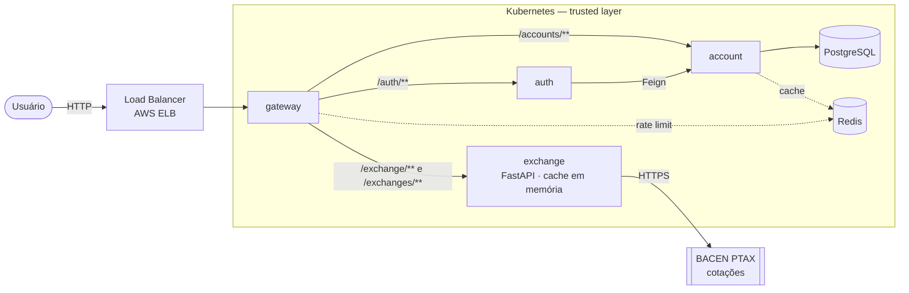

# Plataformas 2026.2 — Projeto **Store**

<div class="grid cards" markdown>

- :material-account: **Alunos:** Enzo Urioste Canavero e Miguel Fernandes Oliveira Damásio
- :material-account-group: **Grupo:** dupla Miguel Damásio + Enzo Canavero (4 microsserviços: Gateway, Auth, Account e Exchange)
- :material-check-all: **Avaliação:** [checklist da rubrica](rubrica.md), item por item, com as evidências
- :material-school: **Disciplina:** Plataformas — Insper, 2026.2
- :material-robot: **IA:** feito com Claude Code — ver [Uso de IA](uso-de-ia.md)

</div>

Plataforma de microsserviços **Spring Boot 4.1 / Java 25** e **Python 3.12 / FastAPI** para uma
loja (compra e venda de produtos), com **API Gateway** (Spring Cloud Gateway), **autenticação JWT**,
**gestão de contas** (PostgreSQL) e **câmbio de moedas** (FastAPI sobre a PTAX do Banco Central,
o serviço do BACEN da disciplina), empacotada em Docker, orquestrada no
**Kubernetes (Amazon EKS)**, com **CI/CD no GitHub Actions**, **bottlenecks** implementados
(cache Redis, circuit breaker/retry, rate limiting, observabilidade, varredura de
vulnerabilidades, autoscaling), **teste de carga com HPA** e **análise de custos**.



## Entregas

- [x] Microsserviços **Gateway**, **Auth**, **Account**, **Exchange** (+ módulos de interface) — [Projeto](projeto/index.md)
- [x] **Bottlenecks** (6, com evidências medidas) — [Bottlenecks](projeto/bottlenecks.md)
- [x] `docker compose` local + smoke test ponta a ponta — [Execução local](projeto/local.md)
- [x] Manifests **Kubernetes** (Secret, ConfigMap, Deployment, Service, HPA, Ingress) + scripts **EKS** (criação com o template de VPC do enunciado e teardown) — [AWS e EKS](projeto/eks.md), [Runbook](projeto/runbook.md)
- [x] **CI/CD** GitHub Actions: build, testes, imagem multi-arch no ECR (ou Docker Hub), Trivy e deploy no EKS — [CI/CD](projeto/cicd.md)
- [x] **Teste de carga** (busybox do enunciado + k6) e roteiro do vídeo do HPA — [Teste de carga](projeto/load-testing.md)
- [x] **Custos, PaaS e SLA** (us-east-2, preços da AWS Price List) — [Custos](projeto/custos.md)
- [x] Apresentação (slides) e roteiro do vídeo de 1–2 min — [Apresentação](projeto/apresentacao.md)
- [x] **Execução real no EKS** (15/11/2026): cluster `eks-store` 1.37, RDS PostgreSQL, imagens no ECR, ELB público, HPA do gateway 1 → 10 réplicas; depois reduzido ao mínimo (2 nós **Spot**, 1 NAT, Postgres no cluster, ECR com lifecycle: US$ 0,34 → **0,21/h**) — [AWS e EKS](projeto/eks.md#deploy-real-no-eks-15112026), [Custos](projeto/custos.md#otimizacoes-aplicadas), [Teste de carga](projeto/load-testing.md#resultado-no-eks)
- [x] Câmbio pelo PTAX do BACEN (público, sem API key): a AwesomeAPI recusava os IPs da AWS sem chave (com a chave, smoke test pelo ELB **14/14**); trocamos após o aviso do professor — [Exchange](projeto/exchange.md) — [AWS e EKS](projeto/eks.md#deploy-real-no-eks-15112026)
- [x] **Exchange em Python/FastAPI** (como pede o enunciado): o serviço do BACEN da disciplina em `api/exchange-py`, com Dockerfile uv, 37 testes, métricas no Grafana e falha rápida medida (10 requisições com a PTAX lenta: ~3 s contra ~30 s do original); smoke test **18/18** com a PTAX real — [Exchange](projeto/exchange.md)
- [x] **E2E no CI** hermético (stub da PTAX do BACEN), smoke test a cada push: 14 verificações até 21/11 e **18** com o exchange-py (7 do câmbio), 18/18 também com a PTAX real — [CI/CD](projeto/cicd.md#e2e-hermetico)
- [x] **Vídeo do teste de carga com HPA** (gateway 1 → 10 réplicas e volta a 1) — [Teste de carga](projeto/load-testing.md#video-do-teste-de-carga)
- [x] **Apresentação** (slides) e **vídeo de 1 min 51 s** narrado — [Apresentação](projeto/apresentacao.md)

## Repositórios

O repositório principal agrega os serviços Java como **submódulos Git** em `api/`, como no
hands-on 0; o Exchange em Python fica numa pasta do próprio repositório principal (`api/exchange-py`):

| Repositório | Papel | Caminho |
|-------------|-------|---------|
| [`Projeto-PMA`](https://github.com/EuMiguelll/Projeto-PMA) | principal: docs, compose, k8s, scripts AWS, teste de carga (entrega do Miguel) | `/` |
| [`platform`](https://github.com/canavero/platform) | mesmo conteúdo, entrega do Enzo ([site](https://canavero.github.io/platform/)) | — |
| [`gateway-service`](https://github.com/canavero/gateway-service) | API Gateway (Spring Cloud Gateway, WebFlux) | `api/gateway-service` |
| [`auth`](https://github.com/canavero/auth) | interface do Auth (Feign + DTOs) | `api/auth` |
| [`auth-service`](https://github.com/canavero/auth-service) | login, emissão e validação de JWT | `api/auth-service` |
| [`account`](https://github.com/canavero/account) | interface do Account (Feign + DTOs) | `api/account` |
| [`account-service`](https://github.com/canavero/account-service) | cadastro e dados de usuários (PostgreSQL) | `api/account-service` |
| [`Projeto-PMA/api/exchange-py`](https://github.com/EuMiguelll/Projeto-PMA/tree/main/api/exchange-py) | **Exchange** em Python/FastAPI (serviço do BACEN da disciplina) | `api/exchange-py` |
| [`exchange`](https://github.com/canavero/exchange) | versão anterior (Java): interface do Exchange (Feign + DTOs) | `api/exchange` |
| [`exchange-service`](https://github.com/canavero/exchange-service) | versão anterior (Java) do Exchange, fora do gateway | `api/exchange-service` |

```bash
git clone --recurse-submodules https://github.com/EuMiguelll/Projeto-PMA.git
cd Projeto-PMA && ./scripts/build.sh && docker compose up -d --build && ./scripts/smoke-test.sh
```

## Vídeos

- **Apresentação (1–2 min):** [Apresentação e vídeo](projeto/apresentacao.md#videos)
- **Teste de carga + HPA:** [Teste de carga](projeto/load-testing.md#video-do-teste-de-carga)
