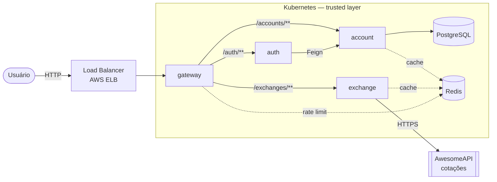

# Plataformas 2026.2 — Projeto **Store**

<div class="grid cards" markdown>

- :material-account: **Aluno:** Enzo Canavero
- :material-account-group: **Grupo:** individual (implementou os 4 microsserviços: Gateway, Auth, Account e Exchange)
- :material-school: **Disciplina:** Plataformas — Insper, 2026.2
- :material-robot: **IA:** feito com Claude Code — ver [Uso de IA](uso-de-ia.md)

</div>

Plataforma de microsserviços **Spring Boot 4.1 / Java 25** para uma loja (compra e venda de
produtos), com **API Gateway** (Spring Cloud Gateway), **autenticação JWT**, **gestão de contas**
(PostgreSQL) e **câmbio de moedas** (API de terceiros), empacotada em Docker, orquestrada no
**Kubernetes (Amazon EKS)**, com **CI/CD no GitHub Actions**, **bottlenecks** implementados
(cache Redis, circuit breaker/retry, rate limiting, observabilidade, varredura de
vulnerabilidades, autoscaling), **teste de carga com HPA** e **análise de custos**.



## Entregas

- [x] Microsserviços **Gateway**, **Auth**, **Account**, **Exchange** (+ módulos de interface) — [Projeto](projeto/index.md)
- [x] **Bottlenecks** (6, com evidências medidas) — [Bottlenecks](projeto/bottlenecks.md)
- [x] `docker compose` local + smoke test ponta a ponta — [Execução local](projeto/local.md)
- [x] Manifests **Kubernetes** (Secret, ConfigMap, Deployment, Service, HPA, Ingress) + scripts **EKS** (criação com o template de VPC do enunciado e teardown) — [AWS e EKS](projeto/eks.md), [Runbook](projeto/runbook.md)
- [x] **CI/CD** GitHub Actions: build, testes, imagem multi-arch no Docker Hub, Trivy e deploy no EKS — [CI/CD](projeto/cicd.md)
- [x] **Teste de carga** (busybox do enunciado + k6) e roteiro do vídeo do HPA — [Teste de carga](projeto/load-testing.md)
- [x] **Custos, PaaS e SLA** (us-east-2, preços da AWS Price List) — [Custos](projeto/custos.md)
- [x] Apresentação (slides) e roteiro do vídeo de 1–2 min — [Apresentação](projeto/apresentacao.md)
- [ ] Execução real no EKS (cluster criado, ELB público) — depende das credenciais AWS
- [ ] Vídeo do teste de carga com HPA no EKS e vídeo de apresentação (1–2 min)

## Repositórios

O repositório principal agrega os serviços como **submódulos Git** em `api/`, como no hands-on 0:

| Repositório | Papel | Caminho |
|-------------|-------|---------|
| [`platform`](https://github.com/canavero/platform) | principal: docs, compose, k8s, scripts AWS, teste de carga | `/` |
| [`gateway-service`](https://github.com/canavero/gateway-service) | API Gateway (Spring Cloud Gateway, WebFlux) | `api/gateway-service` |
| [`auth`](https://github.com/canavero/auth) | interface do Auth (Feign + DTOs) | `api/auth` |
| [`auth-service`](https://github.com/canavero/auth-service) | login, emissão e validação de JWT | `api/auth-service` |
| [`account`](https://github.com/canavero/account) | interface do Account (Feign + DTOs) | `api/account` |
| [`account-service`](https://github.com/canavero/account-service) | cadastro e dados de usuários (PostgreSQL) | `api/account-service` |
| [`exchange`](https://github.com/canavero/exchange) | interface do Exchange (Feign + DTOs) | `api/exchange` |
| [`exchange-service`](https://github.com/canavero/exchange-service) | cotações de câmbio | `api/exchange-service` |

```bash
git clone --recurse-submodules https://github.com/canavero/platform.git
cd platform && ./scripts/build.sh && docker compose up -d --build && ./scripts/smoke-test.sh
```

## Vídeos

- **Apresentação (1–2 min):** _link a adicionar após a gravação_ — roteiro em [Apresentação](projeto/apresentacao.md)
- **Teste de carga + HPA:** _link a adicionar após a gravação_ — roteiro em [Teste de carga](projeto/load-testing.md)
