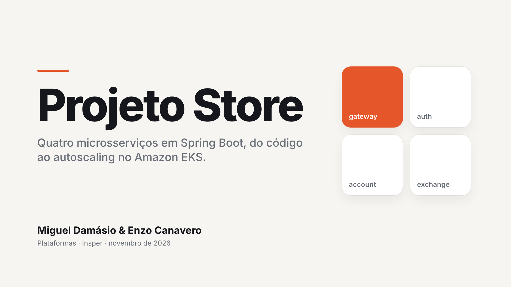
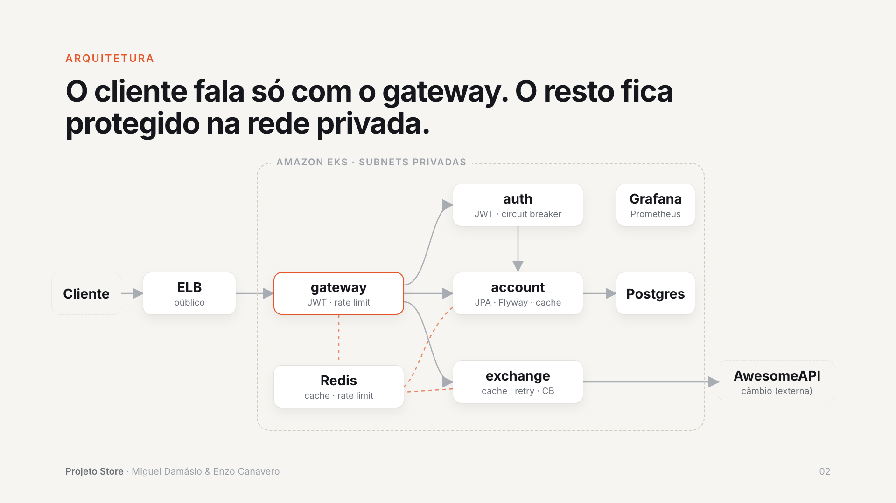
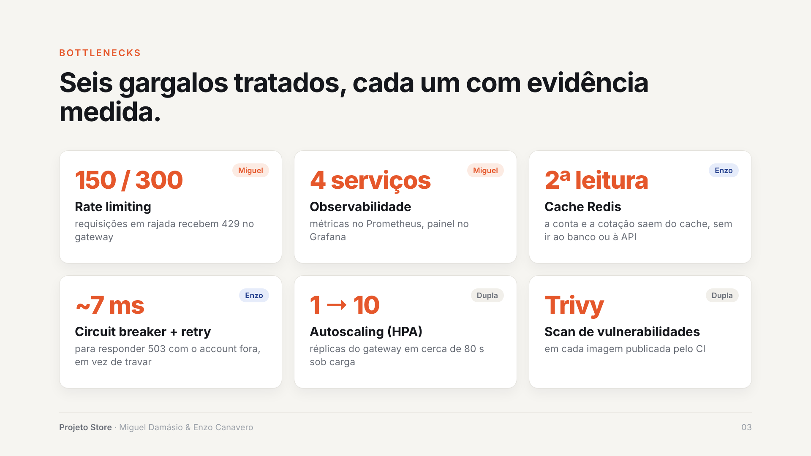
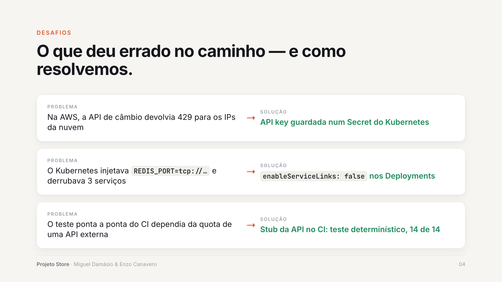
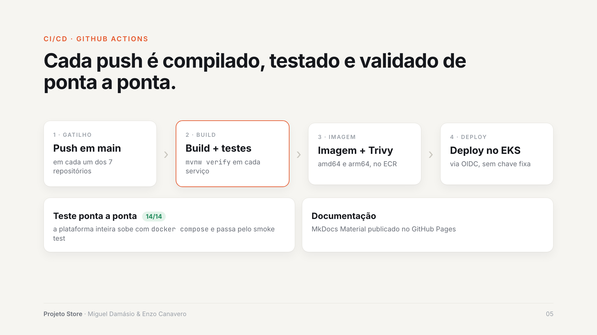
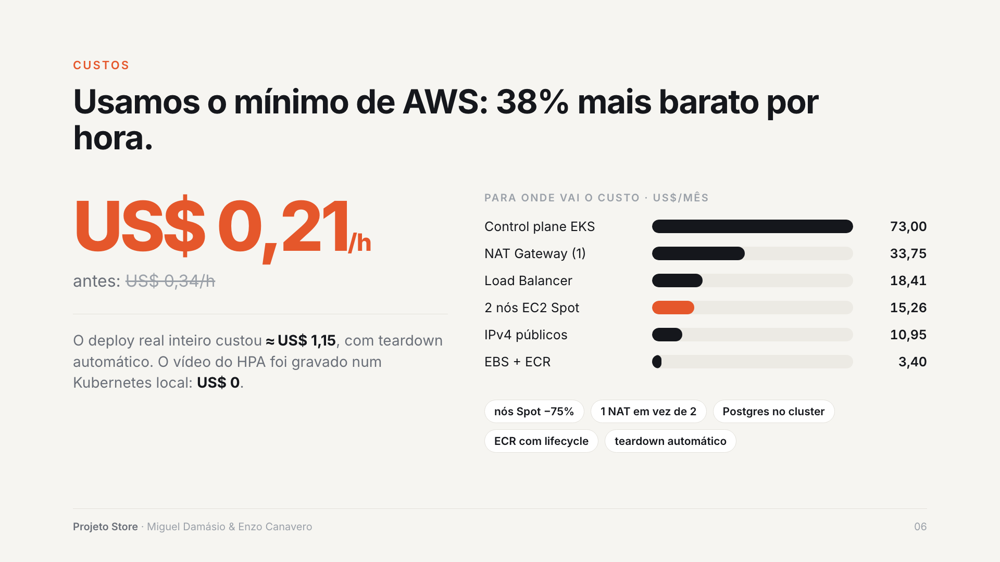
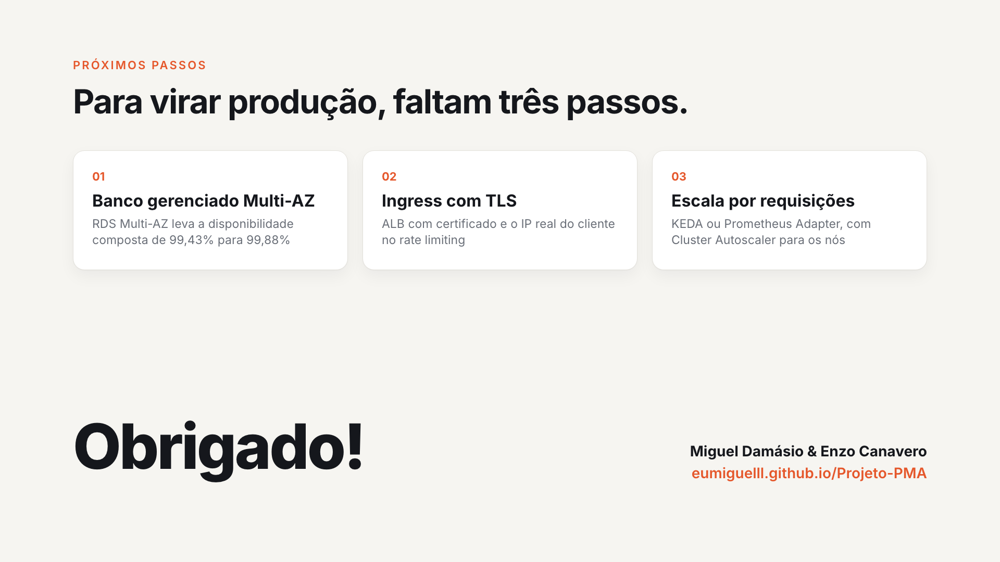

# Apresentação e vídeo

## Vídeos

### Apresentação (1–2 min)

!!! info "Em edição"
    O vídeo já está montado com as gravações reais e o roteiro abaixo; falta só a narração.
    Assim que o áudio for gravado, o vídeo final entra aqui.

### Teste de carga com HPA

<video controls preload="metadata" width="100%">
  <source src="../../videos/teste-de-carga-hpa.mp4" type="video/mp4">
</video>

[Baixar o vídeo do teste de carga](../videos/teste-de-carga-hpa.mp4) · detalhes em
[Teste de carga](load-testing.md#video-do-teste-de-carga)

## Roteiro do vídeo de apresentação

Cobre os tópicos pedidos na página *Presentation*: introdução, arquitetura, demonstração,
desafios/bottlenecks e conclusão com próximos passos.

| Bloco | Tela | Fala |
|------:|------|------|
| 1 | slide de título | "Oi! Eu sou o Miguel Damásio e, com o Enzo Canavero, fizemos o Projeto Store: quatro microsserviços Spring Boot rodando no Amazon EKS." |
| 2 | slide de arquitetura | "O cliente só fala com o gateway, que valida o JWT com o auth. O account guarda os usuários no Postgres, o exchange busca cotações numa API externa e o Redis faz cache e rate limiting." |
| 3 | terminal: smoke test pelo ELB do EKS | "Aqui, a aplicação no ar na AWS, pelo Load Balancer: o smoke test cria um usuário, faz login, lê a conta, que na segunda vez vem do cache, e pega a cotação do dólar. Catorze de catorze." |
| 4 | terminal: rate limiting, Redis, circuit breaker; Grafana | "Implementamos seis bottlenecks. Rate limiting no gateway: de trezentas requisições em rajada, metade volta com 429. Cache no Redis. E circuit breaker: com o account fora do ar, o auth responde 503 em milissegundos, sem travar. Tudo isso aparece no Grafana." |
| 5 | 3 painéis: HPA, pods, busybox (acelerado) | "No teste de carga, o busybox do enunciado gera tráfego e o HPA escala o gateway de uma para dez réplicas em cerca de um minuto; sem carga, ele volta para uma." |
| 6 | slides de desafios/CI e de custos | "Um desafio: na AWS, a API de câmbio bloqueava os IPs da nuvem; resolvemos com uma API key num Secret. O GitHub Actions testa tudo a cada push. E, como custo conta, usamos o mínimo de AWS: nós Spot, um NAT só e Postgres no cluster, de 34 para 21 centavos de dólar por hora, e destruímos o cluster logo depois." |
| 7 | slide de próximos passos | "Próximos passos: banco gerenciado Multi-AZ, Ingress com TLS e escala por requisições. Obrigado!" |

As imagens são gravações reais: o smoke test rodou contra o Load Balancer do EKS em 15/11/2026,
os bottlenecks e o Grafana no `docker compose` local, e o teste de carga num cluster Kubernetes
local (kind) com os mesmos manifests e o mesmo `deploy.sh` do EKS, para não gastar AWS só para
gravar. Os terminais foram gravados com o [VHS](https://github.com/charmbracelet/vhs) e o Grafana
com o Playwright; a montagem foi feita com o `ffmpeg`.

## Slides

PDF: [`presentation/slides.pdf`](https://github.com/EuMiguelll/Projeto-PMA/blob/main/presentation/slides.pdf) ·
fonte HTML: [`presentation/slides.html`](https://github.com/EuMiguelll/Projeto-PMA/blob/main/presentation/slides.html) ·
versão em [Marp](https://marp.app/): [`presentation/slides.md`](https://github.com/EuMiguelll/Projeto-PMA/blob/main/presentation/slides.md) ·
scripts de gravação e montagem dos vídeos: [`presentation/video/`](https://github.com/EuMiguelll/Projeto-PMA/tree/main/presentation/video).
