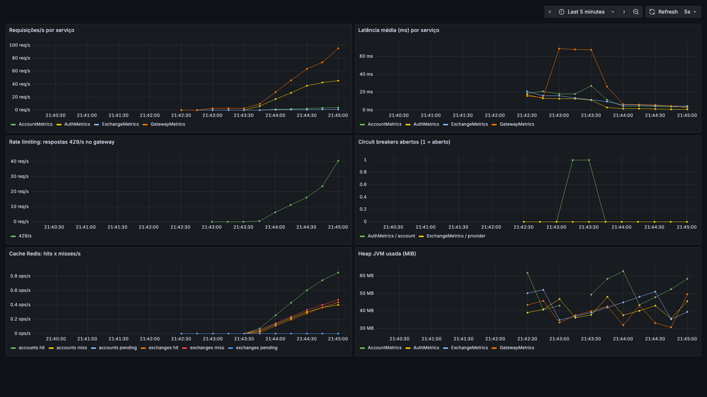
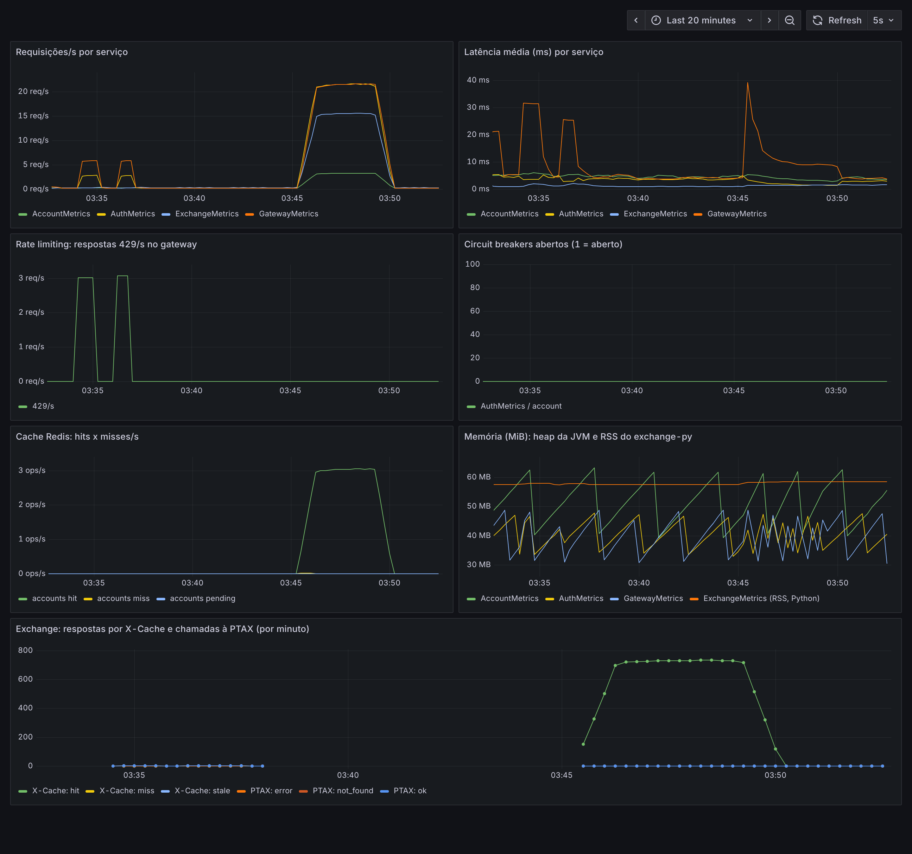

# Bottlenecks

A página *Bottlenecks* da disciplina lista gargalos típicos e suas mitigações. Implementamos **seis**,
pelo menos um em cada serviço, todos validados ao vivo no `docker compose` (as saídas abaixo
são das execuções reais):

| # | Bottleneck (tabela da disciplina) | Onde | Mitigação | Evidência |
|---|-----------------------------------|------|-----------|-----------|
| 1 | **Caching** | account, exchange | account: Redis + Spring Cache (`@Cacheable`/`@CacheEvict`), TTL; exchange: memória do processo (5 min) com lock por moeda | chaves no Redis, `cache_gets_total{result="hit"}`; 300 requisições pelo gateway → **1** chamada à PTAX |
| 2 | **Resiliência** | auth → account, exchange → BACEN | circuit breaker + retry (Resilience4j) no auth; cotação velha (*stale*) e falha rápida no exchange | circuito `OPEN`, 503 em ~5 ms; PTAX lenta: 10 requisições em ~3 s (~30 s no serviço original) |
| 3 | **Load balancing / proteção** (rate limiting) | gateway | `RequestRateLimiter` (token bucket no Redis) | 150 de 300 requisições → `429` |
| 4 | **Observability** | todos | Actuator + Micrometer (Java) e prometheus-client (exchange) → Prometheus → Grafana | 4 targets `UP`, dashboard provisionado |
| 5 | **Vulnerability scanning** | CI de todos os serviços | Trivy na imagem publicada | relatório HIGH/CRITICAL em cada build |
| 6 | **Load balancing / escala horizontal** | Kubernetes | Service + HPA (CPU 50 %) + ELB | [Teste de carga](load-testing.md) |

### Destaques por integrante

A entrega pede **pelo menos 2 bottlenecks em destaque por integrante**. A dupla tem 6; cada um
apresenta e defende os seus:

| Integrante | Bottlenecks em destaque | Onde ver |
|------------|-------------------------|----------|
| **Miguel Damásio** | **3. Rate limiting** no gateway (token bucket no Redis → `429`) e **4. Observabilidade** (Prometheus + Grafana, dashboard *Store — Bottlenecks*) | [§ 3](#3-rate-limiting-gateway), [§ 4](#4-observabilidade-prometheus-grafana) |
| **Enzo Canavero** | **1. Cache** (Redis no account, memória no exchange) e **2. Resiliência** (circuit breaker auth → account; *stale* e falha rápida exchange → BACEN) | [§ 1](#1-cache-account-e-exchange), [§ 2](#2-resiliencia-auth-e-exchange) |
| Dupla | **5. Vulnerability scanning** (Trivy no CI) e **6. Escala horizontal** (HPA + Service + ELB) | [§ 5](#5-vulnerability-scanning-trivy-no-ci), [§ 6](#6-escala-horizontal-e-balanceamento-hpa-service-elb) |



*Dashboard provisionado (`setup/grafana`), com o compose local sob carga em 16/11/2026: req/s e
latência por serviço, `429` do rate limiting, o circuito `auth → account` abrindo (account
parado) e hits/misses do cache Redis.*

---

## 1. Cache (account e exchange)

**Problema.** Toda requisição autenticada a `/auth/me` faz o auth chamar `GET /accounts/{id}`,
que vai ao PostgreSQL; e todo `GET /exchanges/{from}/{to}` iria ao PTAX do BACEN — uma API externa,
lenta (centenas de ms) e fora do nosso controle. Com o gateway escalando para várias réplicas, um
cache **local** (por JVM) não seria compartilhado.

**Solução no account.** Cache-aside com **Redis** compartilhado (hands-on 8):
`spring-boot-starter-data-redis` + `spring-boot-starter-cache`, `@EnableCaching`,
`spring.cache.type: redis`.

**Solução no exchange.** O [exchange-py](exchange.md) guarda a cotação de cada moeda **na
memória do processo**, como no serviço do BACEN da disciplina: a PTAX publica poucos boletins
por dia, então 5 minutos de cache não mudam a resposta, e não há rede nem dependência extra
num hit. Um **lock por moeda** faz a primeira requisição atualizar a cotação enquanto as outras
esperam por ela (sem estouro de chamadas ao BCB quando o cache vence sob carga).

| Cache | Onde | Chave | TTL | Invalidação |
|-------|------|-------|-----|-------------|
| `accounts` | Redis | `accounts::<id>` | 5 min | `@CacheEvict` no `DELETE /accounts/{id}` |
| cotações do exchange | memória do exchange-py | moeda (`USD`, `EUR`…): um par usa as duas | 5 min (`CACHE_SECONDS`) | expira; moeda desconhecida (404) também fica 5 min |

=== "AccountService (Java)"

    ```java
    @Cacheable(value = "accounts", key = "#id", unless = "#result == null")
    public Account findById(String id) { ... }

    @CacheEvict(value = "accounts", key = "#id")
    public void delete(String id) { ... }
    ```

=== "exchange-py (Python)"

    ```python
    async def brl_quote(currency: str) -> tuple[dict, str]:
        if currency == "BRL":
            return BRL, "hit"
        if entry := _fresh(currency):          # hit: nem chega ao lock
            return _answer(currency, entry)
        async with _locks[currency]:           # uma atualização por moeda de cada vez
            if entry := _fresh(currency):      # quem esperou o lock usa a cotação nova
                return _answer(currency, entry)
            return await _refresh(currency)    # chama a PTAX (miss)
    ```

Trade-off do cache em memória: cada réplica tem o seu (com o HPA em 3 réplicas, até 3 chamadas
por moeda a cada 5 min) e um pod reiniciado começa vazio; em troca, o exchange não depende do
Redis e um hit custa microssegundos. Para uma API pública de poucos boletins por dia, a conta
fecha; um cache compartilhado (Redis) só valeria com muitas réplicas.

Decisões:

- **Redis é opcional**: um `LoggingCacheErrorHandler` faz o serviço apenas logar e seguir para o
  banco/API se o Redis cair; o health do Redis foi desligado das probes (`management.health.redis.enabled: false`)
  para o pod não ficar *unready* por causa do cache. Timeouts curtos (500 ms) evitam travar threads.
- Objetos cacheados (`Account`, `Rate`) são `Serializable` (serializador JDK padrão do Spring Data
  Redis, sem configuração extra).
- `cache-names` + `enable-statistics: true` publicam `cache_gets_total{result="hit|miss"}` no Prometheus.

**Evidência no account** (após o smoke test, que lê a mesma conta duas vezes; saída de 16/11,
quando o exchange ainda era a versão Java, com cache no Redis — daí a chave `exchanges::USD-BRL`):

```console
$ docker compose exec redis redis-cli --scan
exchanges::USD-BRL
accounts::7586833b-189d-4f47-a27d-0cf8589a8b3b

$ curl -s account:8080/accounts/actuator/prometheus | grep cache_gets_total
cache_gets_total{cache="accounts",result="hit"} 2.0
cache_gets_total{cache="accounts",result="miss"} 1.0
cache_gets_total{cache="exchanges",result="miss"} 2.0
```

**Evidência no exchange** (22/11, PTAX real; [completa](../evidencias/exchange-py-cache.txt)):
300 requisições a `GET /exchanges/USD/BRL` pelo gateway, 20 em paralelo, depois da primeira
(`miss`). O rate limiting barrou o excesso, todas as que chegaram ao exchange foram `hit`, e o
BCB recebeu **uma** chamada:

```console
    131 HTTP/1.1 200
    169 HTTP/1.1 429
    131 x-cache: hit
$ curl -s exchange:8000/metrics | grep -E '^(ptax_requests_total|exchange_rate_responses_total)'
    ptax_requests_total{outcome="ok"} 1.0
    exchange_rate_responses_total{cache="miss"} 1.0
    exchange_rate_responses_total{cache="hit"} 131.0
```

Nos testes, 20 requisições simultâneas com o cache vazio fazem exatamente 2 chamadas à PTAX
(USD e EUR): o lock segura as outras 18.

---

## 2. Resiliência (auth e exchange)

**Problema.** Chamadas síncronas em cadeia propagam falhas: se o `account` ou o BACEN ficam
lentos/fora, cada requisição segura uma thread até o timeout, o pool esgota e o serviço que
chama também cai (falha em cascata — aula *Reliability patterns*).

**Solução.** No auth, **circuit breaker** do Resilience4j (`resilience4j-spring-boot4` +
`spring-boot-starter-aspectj`); no exchange, a **cotação velha** (*stale*) e uma **falha rápida**
depois de cada erro da PTAX, o mesmo efeito de um circuito aberto:

=== "auth → account (circuit breaker)"

    ```yaml
    resilience4j.circuitbreaker.instances.account:
      sliding-window-size: 10
      minimum-number-of-calls: 5
      failure-rate-threshold: 50          # >= 50 % de falhas -> OPEN
      slow-call-duration-threshold: 1500ms
      wait-duration-in-open-state: 15s    # OPEN -> HALF_OPEN
      permitted-number-of-calls-in-half-open-state: 3
      record-exceptions:                  # só falhas de infraestrutura contam
        - feign.RetryableException        # conexão recusada / timeout
        - feign.FeignException$FeignServerException   # 5xx
    ```

    `@CircuitBreaker(name = "account", fallbackMethod = ...)` em `create`, `login` e `me`.
    O fallback traduz: 4xx do account passa adiante (400/401/404/409) e falha de rede/5xx/circuito
    aberto vira **503**. Credencial errada (401) **não** conta como falha. Timeouts do Feign:
    1 s de conexão, 2 s de leitura.

=== "exchange → BACEN (stale + falha rápida)"

    ```python
    except (httpx.HTTPError, KeyError, TypeError, ValueError) as e:
        PTAX_REQUESTS.labels(outcome="error").inc()
        log.warning("PTAX falhou para %s: %r", currency, e)  # o detalhe fica no log
        # cotação velha é melhor que um erro; sem ela, 502. Nos dois casos, a próxima
        # tentativa só depois de RETRY_SECONDS (falha rápida até lá)
        old = _cache.get(currency)
        quote = old.value if old else None
        _cache[currency] = Entry(time.monotonic() + RETRY_SECONDS, quote, "stale" if quote else "down")
        return _answer(currency, _cache[currency])
    ```

    `PTAX_TIMEOUT` de 3 s (httpx). Depois de uma falha, a moeda fica `RETRY_SECONDS` (30 s) sem
    chamar a PTAX: serve a cotação velha com `X-Cache: stale` ou, se nunca houve uma, `502`
    imediato — o papel do estado `OPEN` de um circuit breaker. Passada a janela, a próxima
    requisição tenta de novo (`HALF_OPEN`, na prática). Sem retry: a PTAX é um serviço público, e
    insistir num provedor lento só aumenta a fila.

**Evidência 1 — account fora do ar** (`docker compose stop account`):

```console
login #1 -> 503 em 0.052821s
login #2 -> 503 em 0.005793s
...
login #8 -> 503 em 0.004062s
{"state":"OPEN","failureRate":"50.0%","notPermittedCalls":3}      # /auth/actuator/circuitbreakers

# docker compose start account; após 15 s (HALF_OPEN) as chamadas de teste passam:
login #1..#4 -> 200
{"state":"CLOSED","failureRate":"-1.0%"}
```

**Evidência 2 — PTAX fora do ar** (stub da PTAX parado, `CACHE_SECONDS=5`, `RETRY_SECONDS=15`;
[completa](../evidencias/exchange-py-cache.txt)):

```console
GET /exchange/USD/EUR -> 200 X-Cache=miss 0.016298s
$ docker compose stop provider-stub && sleep 6     # a cotação vence e a PTAX some
GET /exchange/USD/EUR -> 200 X-Cache=stale 0.018838s   # cotação velha, mesma resposta
GET /exchange/GBP/BRL -> 502 X-Cache=- 0.011373s {"detail":"PTAX unavailable and nothing cached for GBP"}
GET /exchange/GBP/BRL -> 502 X-Cache=- 0.008538s   # falha rápida: nem tentou a PTAX
ptax_requests_total{outcome="error"} 3.0                # USD, EUR e GBP, uma vez cada
$ docker compose start provider-stub && sleep 16   # PTAX de volta, passou o RETRY_SECONDS
GET /exchange/USD/EUR -> 200 X-Cache=miss 0.016724s
```

**Evidência 3 — PTAX lenta** (um servidor que leva 10 s; 10 requisições simultâneas sem cache),
lado a lado com o `main.py` original da página do BACEN:

```console
original     502:3.10s 502:6.10s 502:9.10s 502:12.10s 502:15.10s ... 502:30.10s
exchange-py  502:3.00s 502:3.00s 502:3.00s 502:3.00s 502:3.00s ... 502:3.01s
```

No original, quem esperava o lock tentava a PTAX de novo e a fila andava de 3 em 3 s; com a
falha rápida, uma chamada decide pelas outras nove.

??? note "Versão anterior (exchange-service em Java): retry + circuit breaker do Resilience4j"

    ```yaml
    resilience4j:
      retry.instances.provider:
        max-attempts: 3                   # 1 + 2 tentativas
        wait-duration: 300ms
        enable-exponential-backoff: true  # 300 ms, 600 ms
        retry-exceptions: [ResourceAccessException, HttpServerErrorException]
        ignore-exceptions: [CallNotPermittedException]   # circuito aberto: não insiste
      circuitbreaker.instances.provider:
        minimum-number-of-calls: 5
        failure-rate-threshold: 50
        wait-duration-in-open-state: 30s
        record-exceptions: [ResourceAccessException, HttpServerErrorException, TooManyRequests]
    ```

    Ordem padrão do Resilience4j: `Retry( CircuitBreaker( chamada ) )`; o fallback fica no
    `@Retry` (camada externa) para rodar uma única vez — como na aula. Timeouts do `RestClient`:
    2 s de conexão, 3 s de leitura.

    Evidência (16/11, `EXCHANGE_PROVIDER_URL=http://redis:6380 docker compose up -d exchange`):

    ```console
    EUR/BRL #1 -> 503 em 1.183456s     # 3 tentativas com backoff
    EUR/BRL #2 -> 503 em 0.934587s     # 3 tentativas -> 6 falhas na janela -> OPEN
    EUR/BRL #3 -> 503 em 0.023458s     # circuito aberto: falha rápida, sem chamar a API
    ...
    EUR/BRL #8 -> 503 em 0.008064s
    {"state":"OPEN","failureRate":"100.0%"}
    ```

Sem o padrão, cada chamada seguraria a thread (ou a corrotina) pelos timeouts. Com ele, a falha
custa ~10 ms e o provedor ganha tempo para se recuperar. O estado do circuito do auth é exportado
como `resilience4j_circuitbreaker_state`, e as falhas da PTAX como
`ptax_requests_total{outcome="error"}` (painéis no Grafana).

---

## 3. Rate limiting (gateway)

**Problema.** Um cliente (ou robô) pode inundar o gateway e, através dele, o auth, o account e o
banco. O gateway é o lugar certo para cortar o excesso, antes de qualquer trabalho.

**Solução.** Filtro `RequestRateLimiter` do Spring Cloud Gateway com `RedisRateLimiter`
(token bucket, aula *Reliability patterns*): **50 req/s** de reposição e **rajada de 100** por IP
de origem; acima disso, `429 Too Many Requests`. O estado fica no **Redis**, então o limite vale
para o conjunto de réplicas do gateway (não por pod). Configurável por `RATE_LIMIT_REPLENISH` /
`RATE_LIMIT_BURST`.

```yaml
default-filters:
  - name: RequestRateLimiter
    args:
      key-resolver: "#{@ipKeyResolver}"          # bean: IP de origem
      redis-rate-limiter.replenishRate: ${RATE_LIMIT_REPLENISH:50}
      redis-rate-limiter.burstCapacity: ${RATE_LIMIT_BURST:100}
```

Os endpoints próprios do gateway (`/health-check`, `/info`, actuator) **não** passam pelo filtro
de rota — por isso o teste de carga do HPA usa `/info`. Se o Redis cair, o rate limiter libera as
requisições (*fail-open*) em vez de derrubar a API.

**Evidência** — 300 requisições, 50 em paralelo:

```console
$ seq 300 | xargs -P 50 -I{} curl -s -o /dev/null -w '%{http_code}\n' localhost:8080/auth/logout | sort | uniq -c
 150 200
 150 429
```

As respostas trazem `X-RateLimit-Remaining`, `X-RateLimit-Burst-Capacity` e
`X-RateLimit-Replenish-Rate`.

!!! note "Limitação conhecida"
    Atrás do Classic Load Balancer (modo TCP) o IP de origem visto pelo pod é o do nó, então o
    limite vira praticamente global. Com o ALB (Ingress) daria para usar o `X-Forwarded-For`
    confiável do balanceador como chave.

---

## 4. Observabilidade (Prometheus + Grafana)

Os serviços Java têm `spring-boot-starter-actuator` + `micrometer-registry-prometheus`, com o
endpoint sob o prefixo do serviço (`/gateway/actuator/prometheus`, `/auth/...`, `/accounts/...`),
como no hands-on 6. O `exchange-py` usa o `prometheus-client` em `/metrics`, com o histograma
HTTP no **mesmo nome do Micrometer** (`http_server_requests_seconds`, rótulos `method`, `uri` com
o template da rota e `status`): ele entra nos painéis de req/s e latência sem mudar nenhuma
consulta. O compose sobe **Prometheus** (scrape a cada 5 s) e
**Grafana** com datasource e um dashboard **"Store — Bottlenecks"** provisionados por arquivo
(`setup/grafana/provisioning`), sem configuração manual:

| Painel | PromQL |
|--------|--------|
| Requisições/s por serviço | `sum by (job) (rate(http_server_requests_seconds_count[1m]))` |
| Latência média (ms) | `1000 * sum by (job) (rate(..._sum[1m])) / sum by (job) (rate(..._count[1m]))` |
| 429/s no gateway | `sum(rate(http_server_requests_seconds_count{job="GatewayMetrics",status="429"}[1m]))` |
| Circuit breakers abertos | `max by (job, name) (resilience4j_circuitbreaker_state{state="open"})` |
| Cache hits × misses (Redis) | `sum by (cache, result) (rate(cache_gets_total[1m]))` |
| Memória: heap da JVM e RSS do exchange-py | `sum by (job) (jvm_memory_used_bytes{area="heap"})` e `process_resident_memory_bytes{job="ExchangeMetrics"}` |
| Exchange: `X-Cache` × chamadas à PTAX (por minuto) | `sum by (cache) (increase(exchange_rate_responses_total[1m]))` e `sum by (outcome) (increase(ptax_requests_total[1m]))` |

```console
$ curl -s localhost:9090/api/v1/targets | jq -r '.data.activeTargets[] | "\(.labels.job) \(.health)"'
AccountMetrics up
AuthMetrics up
ExchangeMetrics up
GatewayMetrics up
```



*22/11/2026, compose local com o exchange-py e a PTAX real: o `ExchangeMetrics` entra nos
painéis de req/s, latência e memória sem mudar nenhuma consulta, e o painel de baixo mostra
~720 respostas `X-Cache: hit` por minuto (tráfego de 03:45–03:50 UTC pelo gateway) com a linha
de chamadas à PTAX colada no zero.*

Grafana: <http://localhost:3000> (admin/admin) → *Dashboards → Store → Store — Bottlenecks*.
No Kubernetes, as **probes** de liveness/readiness usam os health groups do Actuator, e o
`metrics-server` alimenta o HPA.

---

## 5. Vulnerability scanning (Trivy no CI)

Cada push em `main` de um serviço publica a imagem e roda o **Trivy** sobre ela
(`aquasec/trivy image --severity HIGH,CRITICAL`). O relatório aparece no log do job
*Imagem (ECR ou Docker Hub, scan)*; está configurado para **não bloquear** (`--exit-code 0`) —
trocar para `1` transforma o scan em *gate*. No ECR, os repositórios também têm *scan on push*
(`aws ecr describe-image-scan-findings --repository-name gateway-service --image-id imageTag=latest`).
No `exchange-py` o Trivy roda na imagem construída no CI, antes de publicar. Outras escolhas que
reduzem superfície de ataque: imagem base **JRE** (sem compilador) nos serviços Java e
`python:3.12-slim` sem as dependências de teste (`uv sync --no-dev`) no exchange, que roda como
UID 10001, sem capabilities e com o sistema de arquivos só leitura no Kubernetes; segredos fora
do código (Secrets do Kubernetes / GitHub), `permissions: contents: read` nos workflows, e o
header `id-account` só pode vir do gateway.

---

## 6. Escala horizontal e balanceamento (HPA + Service + ELB)

O gateway roda atrás de um `Service` `LoadBalancer` (ELB da AWS, subnets públicas) que
distribui entre as réplicas nas subnets privadas; os demais serviços são `ClusterIP`. Cada
serviço tem um **HPA** por CPU (50 % do *request*): gateway 1–10 réplicas, demais 1–3. Como o
estado de sessão está no JWT e o estado compartilhado (cache, rate limit) no Redis, qualquer
réplica atende qualquer requisição. A demonstração está em [Teste de carga](load-testing.md).
