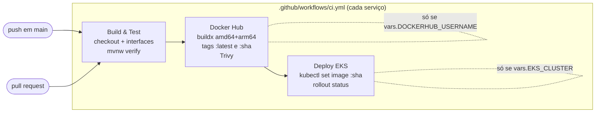

# CI/CD — GitHub Actions

O enunciado aceita Jenkins **ou** GitHub Actions; usei **GitHub Actions** (zero infraestrutura,
gratuito para repositórios públicos), seguindo o apêndice *GitHub Actions* da disciplina e as
etapas pedidas no exercício Jenkins: **SCM → Dependencies → Build → Push to Docker Hub → Deploy to K8s**.



| Job | Quando roda | O que faz |
|-----|-------------|-----------|
| **Build & Test** | todo push e PR | checkout do serviço **e dos módulos de interface** (repositórios irmãos, `mvn install`), `./mvnw verify` (testes + jar), artefato `jar` |
| **Docker Hub** | push (não PR) e variável `DOCKERHUB_USERNAME` definida | QEMU + Buildx, imagem `linux/amd64,linux/arm64`, tags `:latest` e `:<sha>`, **Trivy** (HIGH/CRITICAL) |
| **Deploy EKS** | push em `main` e variável `EKS_CLUSTER` definida | `aws eks update-kubeconfig`, `kubectl set image deployment/<svc> <svc>=<imagem>:<sha>`, `kubectl rollout status` |

Sem as variáveis, os jobs de imagem e deploy ficam **skipped** (não falham) — o pipeline já
funciona antes da AWS existir. Os módulos de interface (`account`, `auth`, `exchange`) têm um
workflow só de build; o repositório principal tem o **E2E** (compose + smoke test com os
submódulos) e o **docs** (MkDocs → GitHub Pages).

??? example "api/auth-service/.github/workflows/ci.yml"

    ```yaml
    --8<-- "api/auth-service/.github/workflows/ci.yml"
    ```

??? example ".github/workflows/e2e.yml (repositório principal)"

    ```yaml
    --8<-- ".github/workflows/e2e.yml"
    ```

## Configuração (uma vez por repositório de serviço)

| Tipo | Nome | Valor |
|------|------|-------|
| variable | `DOCKERHUB_USERNAME` | usuário do Docker Hub |
| secret | `DOCKERHUB_TOKEN` | *personal access token* do Docker Hub (Read & Write) |
| variable | `EKS_CLUSTER` | `eks-store` |
| variable | `AWS_REGION` | `us-east-2` (padrão) |
| secret | `AWS_ACCESS_KEY_ID` / `AWS_SECRET_ACCESS_KEY` | do usuário IAM `github-deployer` (Runbook, passo 7) |
| secret | `AWS_SESSION_TOKEN` | só para credenciais temporárias (AWS Academy) |

O usuário `github-deployer` só tem `eks:DescribeCluster` no IAM e a access policy
`AmazonEKSEditPolicy` restrita ao namespace `default` — suficiente para atualizar imagens, sem
poder administrar o cluster.

## Boas práticas aplicadas

- `permissions: contents: read` (menor privilégio do `GITHUB_TOKEN`); segredos só em *secrets*.
- Cache do Maven (`actions/setup-java` com `cache: maven`).
- Imagem identificada pelo **SHA do commit** — rastreável e imutável; o deploy usa o SHA, não `latest`.
- Deploy com `rollout status`: o job falha se os pods novos não ficarem prontos (readiness probe),
  e o Kubernetes mantém os pods antigos atendendo (rolling update).
- Lint dos workflows com `actionlint` e dos scripts com `shellcheck` antes do commit.
