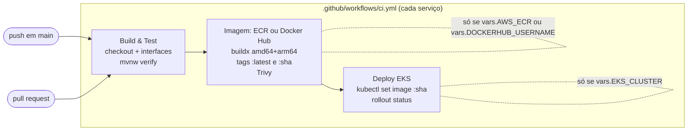

# CI/CD — GitHub Actions

O enunciado aceita Jenkins **ou** GitHub Actions; usamos **GitHub Actions** (zero infraestrutura,
gratuito para repositórios públicos), seguindo o apêndice *GitHub Actions* da disciplina e as
etapas pedidas no exercício Jenkins: **SCM → Dependencies → Build → Push da imagem → Deploy to K8s**.
O registry é o **Amazon ECR** da conta do grupo (o mesmo usado no deploy real) ou o Docker Hub.



| Job | Quando roda | O que faz |
|-----|-------------|-----------|
| **Build & Test** | todo push e PR | checkout do serviço **e dos módulos de interface** (repositórios irmãos, `mvn install`), `./mvnw verify` (testes + jar), artefato `jar` |
| **Imagem** | push (não PR) e variável `AWS_ECR=true` ou `DOCKERHUB_USERNAME` | credenciais AWS por **OIDC** (sem chave fixa), login no ECR (ou Docker Hub), QEMU + Buildx, imagem `linux/amd64,linux/arm64`, tags `:latest` e `:<sha>`, **Trivy** (HIGH/CRITICAL) |
| **Deploy EKS** | push em `main` e variável `EKS_CLUSTER` definida | mesma role OIDC, `aws eks update-kubeconfig`, `kubectl set image deployment/<svc> <svc>=<imagem>:<sha>`, `kubectl rollout status` |

Sem as variáveis, os jobs de imagem e deploy ficam **skipped** (não falham) — o pipeline já
funciona antes da AWS existir. Os módulos de interface (`account`, `auth`, `exchange`) têm um
workflow só de build; o repositório principal tem o **exchange-py** (o Exchange em Python, que
mora nele), o **E2E** (compose + smoke test com os submódulos) e o **docs** (MkDocs → GitHub Pages).

??? example "api/auth-service/.github/workflows/ci.yml"

    ```yaml
    --8<-- "api/auth-service/.github/workflows/ci.yml"
    ```

??? example ".github/workflows/exchange-py.yml (repositório principal)"

    ```yaml
    --8<-- ".github/workflows/exchange-py.yml"
    ```

??? example ".github/workflows/e2e.yml (repositório principal)"

    ```yaml
    --8<-- ".github/workflows/e2e.yml"
    ```

## exchange-py (Python)

O [Exchange](exchange.md) é Python/FastAPI e fica em `api/exchange-py/` do repositório
principal, então o workflow dele está lá, com as mesmas etapas dos serviços Java e filtro de
caminho (`api/exchange-py/**`):

| Job | O que faz |
|-----|-----------|
| **Testes (uv + pytest)** | `astral-sh/setup-uv` com cache do `uv.lock`, `uv sync --frozen` (falha se o lock não bate com o `pyproject.toml`), `uv run pytest -v` (42 testes, PTAX simulada), `ruff check` e `ruff format --check` |
| **Imagem Docker** | `docker build`, sobe o contêiner com a PTAX inacessível de propósito e confere: `HEALTHCHECK` saudável, UID 10001, `/health`, `/exchange/health-check` e `/exchanges/health-check` (`200` sem corpo, sem `id-account`), `502` sem cache, `422` sem `id-account` e com código inválido, contador de erro em `/metrics`; depois o **Trivy** (HIGH/CRITICAL) na imagem |
| **Imagem (ECR ou Docker Hub)** | igual aos serviços Java: `linux/amd64,linux/arm64`, tags `:latest` e `:<sha>`, repositório `exchange-py` |
| **Deploy EKS** | `kubectl set image deployment/exchange exchange=<registry>/exchange-py:<sha>` + `rollout status` |

As variáveis (`AWS_ECR`, `EKS_CLUSTER`…) e o secret `AWS_ROLE_ARN` ficam, nesse caso, no
repositório principal, e a role OIDC precisa aceitar também o `sub` dele
(`repo:<owner>/Projeto-PMA:ref:refs/heads/main`; [Runbook](runbook.md), passo 7).

## Configuração (uma vez por repositório de serviço)

| Tipo | Nome | Valor |
|------|------|-------|
| variable | `AWS_ECR` | `true` (imagem no ECR) |
| secret | `AWS_ROLE_ARN` | role `github-actions-store` (OIDC; Runbook, passo 7) |
| variable | `EKS_CLUSTER` | `eks-store` |
| variable | `AWS_REGION` | `us-east-2` (padrão) |
| variable / secret | `DOCKERHUB_USERNAME` / `DOCKERHUB_TOKEN` | alternativa ao ECR |
| secret | `AWS_ACCESS_KEY_ID` / `AWS_SECRET_ACCESS_KEY` | alternativa ao OIDC (não recomendada) |

A role `github-actions-store` só aceita tokens dos repositórios `*-service` na branch `main`,
tem `AmazonEC2ContainerRegistryPowerUser` + `eks:DescribeCluster` no IAM e a access policy
`AmazonEKSEditPolicy` restrita ao namespace `default` — suficiente para publicar imagens e
atualizar Deployments, sem poder administrar o cluster. Nenhuma chave de longa duração existe,
e o ID da conta não vai para arquivos nem para os logs públicos (`mask-aws-account-id: true`).

## Execuções no GitHub Actions

Os workflows rodam no GitHub a cada push (15/11/2026, 23:01 UTC). O repositório principal tem
duas cópias idênticas: [`canavero/platform`](https://github.com/canavero/platform/actions), onde o
E2E e o deploy das docs rodam, e [`EuMiguelll/Projeto-PMA`](https://github.com/EuMiguelll/Projeto-PMA),
a entrega individual do Miguel, que tem os mesmos arquivos em `.github/workflows/` mas o Actions
desligado (a conta pessoal está com cobrança bloqueada no GitHub). Ali o site é publicado pela
branch `gh-pages` (`mkdocs gh-deploy`).

| Repositório | Workflow | Build & Test | Imagem + Trivy | Deploy EKS |
|-------------|----------|:------------:|:--------------:|:----------:|
| [`gateway-service`](https://github.com/canavero/gateway-service/actions) | CI/CD | ✅ | ⏭️ | ⏭️ |
| [`auth-service`](https://github.com/canavero/auth-service/actions) | CI/CD | ✅ | ⏭️ | ⏭️ |
| [`account-service`](https://github.com/canavero/account-service/actions) | CI/CD | ✅ | ⏭️ | ⏭️ |
| [`exchange-service`](https://github.com/canavero/exchange-service/actions) | CI/CD | ✅ | ⏭️ | ⏭️ |
| [`auth`](https://github.com/canavero/auth/actions), [`account`](https://github.com/canavero/account/actions), [`exchange`](https://github.com/canavero/exchange/actions) | CI (interfaces) | ✅ | — | — |
| [`platform`](https://github.com/canavero/platform/actions) | E2E e docs | ✅ | — | — |
| [`Projeto-PMA`](https://github.com/EuMiguelll/Projeto-PMA/tree/main/.github/workflows) | exchange-py e E2E com o exchange-py | 🖥️ | 🖥️ | ⏭️ |

🖥️ = reproduzido localmente em 22/11/2026, passo a passo e com os mesmos comandos dos
workflows, porque o Actions do `Projeto-PMA` está desligado (abaixo): `uv sync --frozen`, os
testes (37; 42 com o health-check, na noite de 22/11), ruff, `docker build`, o teste do contêiner
do job *Imagem Docker* e o E2E com o stub (smoke test **18/18**; **21/21** com o health-check);
os workflows passam no `actionlint` (com `shellcheck`).
⏭️ = *skipped* de propósito: os jobs de imagem e deploy só ligam com as variáveis `AWS_ECR`/`EKS_CLUSTER`
e a role OIDC. Para o deploy real, os mesmos passos rodaram à mão, com os mesmos comandos
(`push-images.sh` → ECR, `deploy.sh`, `kubectl set image`), como mostram as
[evidências](eks.md#deploy-real-no-eks-15112026). A role OIDC não foi criada: deixaria o ARN da
conta do grupo no GitHub e um cluster ligado esperando deploys, o que contraria a meta de usar o
mínimo de AWS.

### E2E hermético

O E2E sobe a plataforma inteira com `docker compose` e roda o smoke test pelo gateway (21
verificações, 10 do exchange). No CI o `exchange-py` fala com um **stub** da PTAX do BACEN
(nginx com respostas fixas, `setup/provider-stub/default.conf`) que responde às mesmas URLs
OData que o serviço chama: as cotações de `USD` e `EUR` em `CotacaoMoedaPeriodo`, uma lista
vazia para moedas desconhecidas (o exchange responde `404`), como a API real, e a lista de
`Moedas`. O teste fica determinístico e não depende de rede externa. O stub nasceu quando o
exchange ainda usava a AwesomeAPI, que devolvia `429` aos runners do GitHub sem API key; a PTAX
real foi testada pelo mesmo smoke test no compose ([evidência](../evidencias/exchange-py-ptax.txt)).

```bash
PTAX_URL=http://provider-stub docker compose --profile e2e up -d --build \
  db redis provider-stub account auth exchange gateway
./scripts/smoke-test.sh   # 21/21
```

## Boas práticas aplicadas

- `permissions: contents: read` (menor privilégio do `GITHUB_TOKEN`); segredos só em *secrets*.
- Cache do Maven (`actions/setup-java` com `cache: maven`).
- Imagem identificada pelo **SHA do commit** — rastreável e imutável; o deploy usa o SHA, não `latest`.
- Deploy com `rollout status`: o job falha se os pods novos não ficarem prontos (readiness probe),
  e o Kubernetes mantém os pods antigos atendendo (rolling update).
- Lint dos workflows com `actionlint` e dos scripts com `shellcheck` antes do commit.
