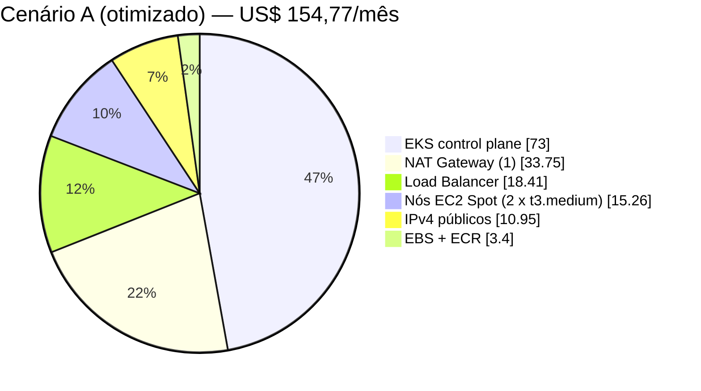
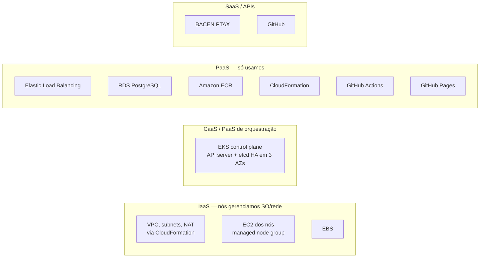

# Custos, PaaS e SLA

## 1. Premissas

- Região **us-east-2 (Ohio)**, a do enunciado. Os preços abaixo são **iguais em us-east-1
  (N. Virginia)** para todos os itens usados.
- Preços *on-demand*, mês de **730 h**, em USD, consultados em **15/11/2026** na
  [AWS Price List](https://pricing.us-east-1.amazonaws.com/offers/v1.0/aws/index.json)
  (EKS, ELB, EC2, RDS e IPv4 público conferidos nos arquivos oficiais; NAT Gateway, EBS e
  ElastiCache pelas páginas de preço de cada serviço). Impostos não incluídos.
- Arquitetura exatamente como os scripts criam (cenário A): template de VPC do enunciado com
  **1 NAT Gateway**, 2 nós `t3.medium` **Spot**, Postgres e Redis dentro do cluster, imagens no
  **ECR** e 1 Classic Load Balancer (Service `LoadBalancer` do gateway). O primeiro deploy
  (2 NAT, nós on-demand, RDS) está no cenário A0, para comparação.

| Item | Preço unitário |
|------|----------------|
| EKS — cluster (suporte padrão) | US$ 0,10 /h |
| EC2 `t3.medium` (2 vCPU, 4 GiB) | US$ 0,0416 /h on-demand · ≈ US$ 0,0095–0,0114 /h Spot (15/11, us-east-2) |
| EC2 `t4g.medium` (Graviton, 2 vCPU, 4 GiB) | US$ 0,0336 /h |
| EC2 `t3.large` (2 vCPU, 8 GiB) | US$ 0,0832 /h |
| EBS gp3 | US$ 0,08 /GB-mês |
| NAT Gateway | US$ 0,045 /h + US$ 0,045 /GB processado |
| IPv4 público (NAT, ELB) | US$ 0,005 /h por IP |
| Classic Load Balancer | US$ 0,025 /h + US$ 0,008 /GB |
| Application / Network Load Balancer | US$ 0,0225 /h + LCU (US$ 0,008 / 0,006 por LCU-h) |
| RDS PostgreSQL `db.t4g.micro` | US$ 0,016 /h (Single-AZ) · US$ 0,032 /h (Multi-AZ) |
| RDS PostgreSQL `db.t4g.small` | US$ 0,032 /h (Single-AZ) · US$ 0,065 /h (Multi-AZ) |
| RDS armazenamento gp3 | US$ 0,115 /GB-mês |
| ElastiCache `cache.t4g.micro` | US$ 0,016 /h |
| ECR armazenamento | US$ 0,10 /GB-mês (transferência na mesma região grátis) |
| Transferência para a internet | 100 GB/mês grátis; depois US$ 0,09 /GB |

## 2. Estimativa mensal

### A — Ambiente atual, otimizado (como os scripts criam agora)

Depois do primeiro deploy (cenário A0, abaixo), o ambiente foi reduzido ao mínimo que ainda
cumpre o enunciado e aguenta o teste de carga: nós **Spot**, **1 NAT Gateway**, **sem RDS**
(Postgres no cluster), **1 Load Balancer** e **lifecycle no ECR**.

| Componente | Cálculo | US$/mês |
|------------|---------|--------:|
| EKS control plane | 0,10 × 730 | 73,00 |
| Nós EC2 **Spot** (2 × `t3.medium`; o node group aceita `t3a.medium`) | 2 × ≈ 0,01045 × 730 | 15,26 |
| EBS dos nós | 2 × 20 GB × 0,08 | 3,20 |
| NAT Gateway (1, compartilhado pelas 2 subnets privadas) | 0,045 × 730 | 32,85 |
| NAT — dados | 20 GB × 0,045 | 0,90 |
| IPv4 públicos | 3 (1 NAT + 2 ELB) × 0,005 × 730 | 10,95 |
| Classic Load Balancer (o único) | 0,025 × 730 + 20 GB × 0,008 | 18,41 |
| Postgres e Redis no cluster | usam os nós | 0,00 |
| ECR (≈ 2,0 GB, com lifecycle) | 2,0 × 0,10 | 0,20 |
| GitHub Actions + Pages | repositórios públicos | 0,00 |
| Transferência para a internet | < 100 GB | 0,00 |
| **Total** | | **≈ 154,77** |
| **Por hora** | | **≈ 0,21** |

O preço Spot muda com a oferta. Em 15/11/2026, às 22:47 UTC
(`aws ec2 describe-spot-price-history`), estava em US$ 0,0095/h (us-east-2a) e US$ 0,0114/h
(us-east-2b) para o `t3.medium`, contra US$ 0,0416/h on-demand, ou seja, **75 % mais barato**.



Agora o maior custo é o **control plane do EKS** (47 %), que é fixo: a única alavanca é o
tempo ligado. Por isso o teardown automático de segurança caiu de 8 h para **3 h**.

### Otimizações aplicadas

Feitas em 15/11/2026, entre 22:40 e 23:00 UTC, com o cluster no ar.

| Otimização | Antes | Depois | Economia US$/h | US$/mês |
|------------|-------|--------|---------------:|--------:|
| Nós **Spot** (node group `eks-store-spot`, `t3.medium`/`t3a.medium`, mín. 1, máx. 2) | 2 × `t3.medium` on-demand (0,0832) | 2 × `t3.medium` Spot (0,0209) | 0,0623 | 45,48 |
| **1 NAT Gateway** para as 2 subnets privadas (template alterado; `aws cloudformation deploy` removeu NAT e EIP da AZ2) | 2 NAT + 2 IPv4 (0,1000) | 1 NAT + 1 IPv4 (0,0500) | 0,0500 | 36,50 |
| **Sem RDS**: Postgres no cluster (`k8s/postgres.yaml`) | `db.t4g.micro` + 20 GB gp3 (0,0192) | 0 | 0,0192 | 13,98 |
| **ECR com lifecycle**: sem tag expira em 1 dia; ficam só as 3 últimas com tag. Imagem órfã apagada; `push-images.sh` passa a publicar só `amd64` | 2,55 GB | 2,05 GB (≈ 1 GB nos próximos pushes) | — | ≈ 0,05–0,15 |
| **1 Load Balancer** só (o Service `gateway`; o Ingress/ALB não é aplicado) | 1 | 1 | — | — |
| Teardown automático de segurança | 8 h | **3 h** | — | pior caso planejado de US$ 3,25 para US$ 1,15 (real: ≈ US$ 1,24, ver abaixo) |
| `eks-create.sh` cria o cluster com `--upgrade-policy supportType=STANDARD` | suporte estendido (US$ 0,60/h quando a versão sai do suporte padrão) | upgrade automático | — | evita +US$ 365/mês |
| **Total** | **0,342/h** | **0,211/h** | **0,1315 (−38 %)** | **≈ 95,96** |

A troca foi feita com o cluster no ar: o node group Spot subiu ao lado do antigo, o EKS drenou
os pods para ele, e o ELB seguiu respondendo 200. O smoke test pelo ELB deu os mesmos
**11/14** de antes (as 3 falhas eram do câmbio, por falta da API key da AwesomeAPI; com a chave
no Secret, **14/14**; desde 16/11 o câmbio usa o PTAX do BACEN, sem chave).

**Avaliado e não aplicado:**

| Ideia | Economia | Por que não |
|-------|---------:|-------------|
| Nenhum NAT (nós nas subnets públicas, com IP público) | −0,04/h | o enunciado põe os pods em subnets **privadas**, e os nós ficariam expostos com IP público |
| 1 nó só | −0,01/h | o HPA do gateway não passaria de ~3 réplicas (falta memória: cada réplica pede 384 Mi). Fora da gravação dá para usar `desiredSize=1` (o mínimo do node group já é 1) |
| `t3.small` (2 GiB) | −0,01/h | 4 JVMs × 384 Mi + Postgres já lotam 2 nós; o HPA ficaria `Pending` |
| Tirar o Load Balancer (NodePort/port-forward) | −0,035/h | o enunciado pede acesso público pelo LB |
| Fargate no lugar dos nós | — | cobra por pod: ~15 pods × (0,25 vCPU + 0,5 GB) ≈ US$ 0,19/h, contra US$ 0,02/h dos 2 nós Spot |

!!! warning "O que o Spot e o Postgres no cluster custam em confiabilidade"
    - **Spot**: a AWS pode retomar um nó com 2 min de aviso. O EKS drena o nó, e os pods sobem no
      outro (ou no substituto que o node group cria). Com 2 tipos de instância e 2 AZs, o risco
      de ficar sem capacidade é baixo. Para dev/teste e para o vídeo, é aceitável.
    - **Postgres no cluster** (Deployment sem volume persistente): se o pod for recriado, os dados
      somem, e o `account` precisa reiniciar para o Flyway recriar o schema. Em produção, o
      cenário C usa RDS Multi-AZ (`aws/rds-create.sh` continua no repositório e foi validado no
      primeiro deploy: Flyway migrou, smoke test 11/14).

### A0 — Primeiro deploy (antes da otimização)

| Componente | Cálculo | US$/mês |
|------------|---------|--------:|
| EKS control plane | 0,10 × 730 | 73,00 |
| Nós EC2 on-demand | 2 × 0,0416 × 730 | 60,74 |
| EBS dos nós | 2 × 20 GB × 0,08 | 3,20 |
| NAT Gateways (template original: 1 por AZ) | 2 × 0,045 × 730 | 65,70 |
| NAT — dados | 20 GB × 0,045 | 0,90 |
| IPv4 públicos | 4 (2 NAT + 2 ELB) × 0,005 × 730 | 14,60 |
| Classic Load Balancer | 0,025 × 730 + 20 GB × 0,008 | 18,41 |
| RDS PostgreSQL `db.t4g.micro` Single-AZ + 20 GB gp3 | 0,016 × 730 + 20 × 0,115 | 13,98 |
| ECR (`amd64` + `arm64`, ≈ 1,4 GB estimados) | 1,4 × 0,10 | 0,14 |
| **Total** | | **≈ 250,67** (≈ 0,34/h) |

### Custo real do deploy de 15/11/2026

Linha do tempo (UTC), conferida com a AWS CLI:

| Período | Configuração | US$/h | Horas | Custo |
|---------|--------------|------:|------:|------:|
| 21:29 → 22:47 | A0: 2 NAT, 2 × `t3.medium` on-demand, RDS | 0,342 | 1,3 | ≈ 0,44 |
| 22:47 → 23:00 | troca: Spot sobe, NAT2 sai às 22:49, nós on-demand saem às 22:55, RDS às 23:00 | ≈ 0,30 | 0,2 | ≈ 0,07 |
| 23:00 → 02:18 (16/11) | A otimizado; o teardown automático agendado para 01:43 não disparou | 0,211 | 3,3 | ≈ 0,70 |
| 02:18 → 02:30 | teardown pelo AWS CloudShell (LB → node group → cluster → VPC → ECR) | ≈ 0,15 | 0,2 | ≈ 0,03 |
| **Total** | | | **≈ 5,0** | **≈ US$ 1,24** |

Antes da otimização, o pior caso (tudo ligado até o teardown de 8 h) era **≈ US$ 3,25**.

!!! warning "O teardown automático não disparou"
    O agendamento de segurança rodava no Mac de um integrante e não executou às 01:43 UTC. Às 01:52
    conferimos de fora que o Load Balancer ainda respondia `200`, entramos na conta pelo AWS access
    portal e rodamos os passos do `aws/eks-teardown.sh` no **AWS CloudShell** (02:18–02:30 UTC). Em
    seguida, uma varredura em **todas as regiões** (EKS, EC2, NAT, Load Balancers, IPs elásticos, RDS)
    voltou vazia. O atraso custou ≈ US$ 0,12 a mais. Lição: o teardown automático precisa rodar num
    lugar que não dorme (por exemplo, um *AWS Budget* com ação ou uma regra do EventBridge na própria
    conta), não num notebook. Evidência: [`docs/evidencias/teardown.txt`](https://github.com/EuMiguelll/Projeto-PMA/blob/main/docs/evidencias/teardown.txt).

**Cost Explorer**: está habilitado na conta e mostrava **US$ 0,00** de 01/11 a 15/11 (consultado
às 23:05 UTC de 15/11; nenhum recurso existia antes desta sessão). A AWS publica os custos com
~24 h de atraso, então o valor desta sessão aparece a partir de 16–17/11:

```bash
aws ce get-cost-and-usage --time-period Start=2026-11-15,End=2026-11-18 --granularity DAILY \
  --metrics UnblendedCost --group-by Type=DIMENSION,Key=SERVICE \
  --query 'ResultsByTime[].[TimePeriod.Start, Groups[].[Keys[0], Metrics.UnblendedCost.Amount]]'
```

Outras alavancas para um ambiente que fique ligado: **Savings Plans** de 1 ano (~30–40 % em
EC2), nós **Graviton** (`t4g.medium` Spot, com `PLATFORMS=linux/arm64` no `push-images.sh`) e
**desligar fora do horário** (`desiredSize=0` no node group; o control plane continua cobrando).

### C — Produção pequena com alta disponibilidade

| Componente | Configuração | US$/mês |
|------------|--------------|--------:|
| EKS | 1 cluster | 73,00 |
| Nós | 3 × `t3.large` (1 por AZ) + 3 × 30 GB gp3 | 189,41 |
| NAT | 2 NAT + 100 GB | 70,20 |
| Load Balancer | ALB (Ingress) + ~2 LCU | 28,11 |
| IPv4 | 4 IPs | 14,60 |
| Banco | RDS `db.t4g.small` **Multi-AZ** + 50 GB gp3 Multi-AZ | 58,95 |
| Cache | ElastiCache `cache.t4g.micro` primário + réplica | 23,36 |
| Registry | ECR (≈ 2 GB) | 0,20 |
| Logs/métricas | CloudWatch (estimado) | 10,00 |
| Transferência | 200 GB (100 grátis) | 9,00 |
| **Total** | | **≈ 476,83** |

Em produção, voltam os 2 NAT (um por AZ) e o RDS Multi-AZ, e os nós passam a ser on-demand:
o que o cenário A economiza aqui, ele paga em disponibilidade.

### AWS Pricing Calculator

Para reproduzir (e gerar o link compartilhável) em <https://calculator.aws/#/>, região
*US East (Ohio)*, crie um grupo **"Store — cenário A"** com:

1. **Amazon EKS** — 1 cluster, 730 h.
2. **Amazon EC2** — 2 instâncias `t3.medium`, Linux, **Spot** (a calculadora usa o preço Spot
   médio histórico), 100 % de uso; EBS gp3 20 GB cada.
3. **Amazon VPC** — NAT Gateway: 1, 20 GB processados; *Public IPv4 addresses*: 3 em uso.
4. **Elastic Load Balancing** — Classic Load Balancer: 1, 20 GB processados.
5. **Amazon ECR** — 2 GB armazenados.

O total deve ficar perto da tabela A (≈ US$ 155/mês; o Spot da calculadora varia um pouco).
Para o cenário C, acrescente o RDS for PostgreSQL (`db.t4g.small`, Multi-AZ, 50 GB gp3).

**Link da estimativa (cenário A, us-east-2):**
<https://calculator.aws/#/estimate?id=9a7c8ac46c02728fc7e7ae43ea1fff1426cc25f2>
(gerada em 16/11/2026; o link público vale por 1 ano)

| Serviço na calculadora | Configuração | US$/mês |
|------------------------|--------------|--------:|
| Amazon EKS | 1 cluster, suporte padrão | 73,00 |
| Amazon EC2 | 2 × `t3.medium` Linux, **Spot** (desconto histórico de 69 % que a calculadora sugere) + EBS 20 GB cada | 22,03 |
| Amazon VPC | 1 NAT Gateway (1 AZ, 20 GB) + 3 IPv4 públicos | 44,70 |
| Elastic Load Balancing | 1 Classic Load Balancer (≈ 20 GB/mês) | 18,43 |
| Amazon ECR | 2 GB armazenados | 0,20 |
| **Total** | | **158,36** |

A diferença para a tabela A (US$ 154,77) é o Spot: a calculadora usa o desconto médio histórico
(69 %), e nós medimos 75 % no dia do deploy. A versão atual da calculadora modela o NAT como
*Regional NAT Gateway*; com 1 AZ ativa, o preço é o mesmo do NAT zonal (US$ 0,045/h + US$ 0,045/GB).

## 3. ECR × Docker Hub

| | Amazon ECR (usado no EKS) | Docker Hub (alternativa) |
|-|---------------------------|--------------------------|
| Custo | US$ 0,10/GB-mês (≈ US$ 0,20 aqui, limitado pela lifecycle policy); pull na mesma região grátis | grátis (repositórios públicos) |
| Limite de pull | sem limite prático | 10/h por IP sem login; 100/h com login (Personal) |
| Privacidade | privado, IAM (a role dos nós já tem `AmazonEC2ContainerRegistryReadOnly`) | imagens públicas |
| Segurança | *scan on push* (vulnerabilidades) grátis | — |
| Integração | nativa com EKS, IAM e OIDC do GitHub Actions | qualquer cluster/CI |

No deploy real usamos o **ECR** da conta do grupo: não havia Docker Hub configurado, o pull não
tem limite, as imagens ficam privadas e os nós autenticam pela role do node group, sem segredo
no cluster. O custo é de centavos. O Docker Hub (padrão do hands-on 4) continua funcionando com
`DOCKERHUB_USERNAME=<usuario>` nos scripts e no CI.

## 4. PaaS — onde o projeto usa



| Serviço | Modelo | Como foi usado | O que deixamos de gerenciar |
|---------|--------|----------------|-----------------------------|
| **Amazon EKS** | CaaS/PaaS | control plane do Kubernetes | instalação, HA, backup do etcd, upgrades do API server |
| **Managed node group** | IaaS gerenciado | nós EC2 com AMI otimizada | provisionamento e substituição de nós, drain em upgrades |
| **Elastic Load Balancing** | PaaS | criado automaticamente pelo `Service` `LoadBalancer` | servidores de balanceamento, health checks, escala do LB |
| **Amazon RDS** | PaaS (DBaaS) | PostgreSQL 17 em subnet privada no primeiro deploy (validado e depois removido para cortar custo; volta no cenário C) | patches, backups, failover Multi-AZ, storage |
| **Amazon ECR** | PaaS (registry) | imagens privadas dos 4 serviços, *scan on push* | servidor de registry, storage, autenticação |
| **CloudFormation** | PaaS (IaC) | VPC do template do enunciado | ordem de criação/remoção de 20+ recursos de rede |
| **GitHub Actions** | PaaS (CI/CD) | build, teste, imagem, deploy | servidor Jenkins, agentes, plugins |
| **GitHub Pages** | PaaS (hosting) | esta documentação | servidor web, TLS, CDN |
| **BACEN (PTAX)** | API pública | cotações de câmbio; sem API key e sem custo, responde para IPs da AWS | coleta e atualização das cotações |

**Alternativas mais "PaaS"**: rodar os 4 contêineres no **ECS Fargate** (sem nós nem control
plane pago: 4 tarefas de 0,25 vCPU / 0,5 GB ≈ 4 × (0,25 × 0,04048 + 0,5 × 0,004445) × 730 ≈
**US$ 36/mês** + ALB) ou no **App Runner** (escala até zero requisições). O EKS foi mantido por
ser o requisito da disciplina e pela portabilidade (os mesmos manifests rodam em minikube/kind
ou em outra nuvem); o custo fixo do control plane (US$ 73) é o preço dessa portabilidade.

## 5. SLA, SLO e SLI

### SLAs dos componentes AWS (mensais, publicados pela AWS)

| Componente | SLA |
|------------|----:|
| Elastic Load Balancing | 99,99 % |
| Amazon EKS (API do cluster) | 99,95 % |
| Amazon EC2 (nível de região, instâncias em ≥ 2 AZs) | 99,99 % |
| Amazon EC2 (instância individual) | 99,5 % |
| Amazon RDS Single-AZ | 99,5 % |
| Amazon RDS Multi-AZ | 99,95 % |

### Disponibilidade composta (componentes em série)

$$
A = A_{ELB} \times A_{EKS} \times A_{EC2} \times A_{DB}
$$

| Cenário | Cálculo | Disponibilidade | Indisponibilidade/mês |
|---------|---------|----------------:|----------------------:|
| A0 (RDS Single-AZ) | 0,9999 × 0,9995 × 0,9999 × 0,995 | **99,43 %** | ≈ 4 h 10 min |
| C (RDS Multi-AZ, ≥ 2 réplicas em 2+ AZs) | 0,9999 × 0,9995 × 0,9999 × 0,9995 | **99,88 %** | ≈ 53 min |
| A (atual: Postgres no cluster, 1 pod sem volume, nós Spot) | sem SLA — 1 pod é ponto único de falha e perde dados; o Spot pode retomar um nó | — | — |

### SLO e SLA propostos para a API Store

| | Definição | Meta |
|-|-----------|------|
| **SLI de disponibilidade** | requisições ao gateway sem erro 5xx ÷ total, janela de 30 dias | — |
| **SLI de latência** | p95 de `GET /exchanges/*` (com cache) | — |
| **SLO** (interno) | disponibilidade | **99,5 %** (orçamento de erro: 0,5 % ≈ 3 h 36 min/mês, ou 5.000 erros a cada 1 milhão de requisições) |
| **SLO** (interno) | latência p95 | < 300 ms |
| **SLA** (contrato) | disponibilidade mensal | **99,0 %** — abaixo disso, crédito de 10 % (25 % abaixo de 95 %) |

O SLA é mais folgado que o SLO de propósito: o SLO dispara a reação (congelar deploys, priorizar
confiabilidade) **antes** de o contrato ser quebrado — como na aula *SLI/SLO/SLA*. O SLO de
99,5 % também é compatível com o cenário A0 + RDS Single-AZ (99,43 % de piso teórico só seria um
problema em um mês com falha longa do banco). O cenário A atual é de dev/teste e não promete
SLA. Para garantir 99,5 % com folga, use o cenário C.

SLIs medidos com as métricas que o projeto já exporta para o Prometheus:

```promql
# disponibilidade (30 dias)
1 - sum(rate(http_server_requests_seconds_count{job="GatewayMetrics",status=~"5.."}[30d]))
  / sum(rate(http_server_requests_seconds_count{job="GatewayMetrics"}[30d]))

# taxa de queima do orçamento (alerta se > 14,4 por 1 h — consome 2 % do orçamento)
(sum(rate(http_server_requests_seconds_count{job="GatewayMetrics",status=~"5.."}[1h]))
  / sum(rate(http_server_requests_seconds_count{job="GatewayMetrics"}[1h]))) / 0.005
```

O que no projeto protege o SLO: readiness probes + rolling update (deploy sem downtime),
circuit breakers (falha rápida e parcial em vez de cascata), cache (o exchange continua
respondendo por até 60 s com o BACEN fora), rate limiting (protege contra sobrecarga), HPA
(capacidade acompanha a demanda) e nós em 2 AZs.
