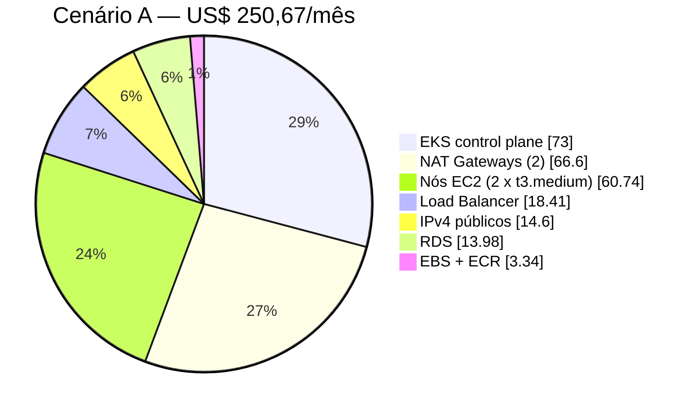

# Custos, PaaS e SLA

## 1. Premissas

- Região **us-east-2 (Ohio)**, a do enunciado. Os preços abaixo são **iguais em us-east-1
  (N. Virginia)** para todos os itens usados.
- Preços *on-demand*, mês de **730 h**, em USD, consultados em **15/11/2026** na
  [AWS Price List](https://pricing.us-east-1.amazonaws.com/offers/v1.0/aws/index.json)
  (EKS, ELB, EC2, RDS e IPv4 público conferidos nos arquivos oficiais; NAT Gateway, EBS e
  ElastiCache pelas páginas de preço de cada serviço). Impostos não incluídos.
- Arquitetura exatamente como os scripts criaram no deploy real: template de VPC do enunciado
  (**2 NAT Gateways**), 2 nós `t3.medium`, **RDS PostgreSQL `db.t4g.micro`**, Redis dentro do
  cluster, imagens no **ECR** e 1 Classic Load Balancer (Service `LoadBalancer` do gateway).

| Item | Preço unitário |
|------|----------------|
| EKS — cluster (suporte padrão) | US$ 0,10 /h |
| EC2 `t3.medium` (2 vCPU, 4 GiB) | US$ 0,0416 /h |
| EC2 `t4g.medium` (Graviton, 2 vCPU, 4 GiB) | US$ 0,0336 /h |
| EC2 `t3.large` (2 vCPU, 8 GiB) | US$ 0,0832 /h |
| EBS gp3 | US$ 0,08 /GB-mês |
| NAT Gateway | US$ 0,045 /h + US$ 0,045 /GB processado |
| IPv4 público (NAT, ELB) | US$ 0,005 /h por IP |
| Classic Load Balancer | US$ 0,025 /h + US$ 0,008 /GB |
| Application / Network Load Balancer | US$ 0,0225 /h + LCU (US$ 0,008 / 0,006 por LCU-h) |
| RDS PostgreSQL `db.t4g.micro` | US$ 0,016 /h (Single-AZ) · US$ 0,032 /h (Multi-AZ) |
| RDS PostgreSQL `db.t4g.small` | US$ 0,032 /h (Single-AZ) · US$ 0,065 /h (Multi-AZ) |
| RDS armazenamento gp3 | US$ 0,115 /GB-mês |
| ElastiCache `cache.t4g.micro` | US$ 0,016 /h |
| ECR armazenamento | US$ 0,10 /GB-mês (transferência na mesma região grátis) |
| Transferência para a internet | 100 GB/mês grátis; depois US$ 0,09 /GB |

## 2. Estimativa mensal

### A — Ambiente do projeto (como os scripts criam)

| Componente | Cálculo | US$/mês |
|------------|---------|--------:|
| EKS control plane | 0,10 × 730 | 73,00 |
| Nós EC2 | 2 × 0,0416 × 730 | 60,74 |
| EBS dos nós | 2 × 20 GB × 0,08 | 3,20 |
| NAT Gateways (template: 1 por AZ) | 2 × 0,045 × 730 | 65,70 |
| NAT — dados | 20 GB × 0,045 | 0,90 |
| IPv4 públicos | 4 (2 NAT + 2 ELB) × 0,005 × 730 | 14,60 |
| Classic Load Balancer | 0,025 × 730 + 20 GB × 0,008 | 18,41 |
| RDS PostgreSQL `db.t4g.micro` Single-AZ + 20 GB gp3 | 0,016 × 730 + 20 × 0,115 | 13,98 |
| Redis no cluster | usa os nós | 0,00 |
| ECR (4 imagens `amd64` + `arm64`, ≈ 1,4 GB) | 1,4 × 0,10 | 0,14 |
| GitHub Actions + Pages | repositórios públicos | 0,00 |
| Transferência para a internet | < 100 GB | 0,00 |
| **Total** | | **≈ 250,67** |
| **Por hora** | 250,67 ÷ 730 | **≈ 0,34** |



!!! info "Custo da entrega"
    O projeto não precisa do cluster ligado o mês inteiro: uma sessão de **3 h** (criar, implantar,
    gravar o teste de carga, destruir) custa **≈ 3 × 0,34 ≈ US$ 1,03**. O maior risco financeiro é
    **esquecer o cluster ligado** (≈ US$ 8,20 por dia) — por isso o `eks-teardown.sh`, o
    teardown automático de segurança (8 h) e o alerta do AWS Budgets no Runbook.

### Custo real do deploy de 15/11/2026

Recursos criados (UTC): NAT Gateways 21:29, cluster 21:31, nós 21:39, RDS 21:43, ELB 21:48.
Com tudo ligado, o custo por hora é:

| Item | US$/h |
|------|------:|
| EKS control plane | 0,1000 |
| 2 NAT Gateways | 0,0900 |
| 2 × `t3.medium` | 0,0832 |
| Classic Load Balancer | 0,0250 |
| 4 IPv4 públicos (2 NAT + 2 do ELB, conferidos com `aws ec2 describe-network-interfaces`) | 0,0200 |
| RDS `db.t4g.micro` + 20 GB gp3 | 0,0192 |
| EBS 2 × 20 GB gp3 | 0,0044 |
| **Total** | **≈ 0,342** |

| Cenário | Horas | Custo |
|---------|------:|------:|
| Criar, implantar, smoke test e teste de carga (21:29 → 22:30) | ≈ 1 | ≈ US$ 0,34 |
| Até a gravação do vídeo do HPA e o teardown manual (estimado) | ≈ 4 | ≈ US$ 1,40 |
| Pior caso: ninguém destrói e o teardown automático roda após 8 h | ≈ 9,5 | ≈ US$ 3,25 |

Some a isso centavos de NAT por GB (pull das imagens do ECR pelos nós, ≈ 1,5 GB × 0,045) e de
CPU acima do baseline dos `t3` (modo *unlimited*).

**Cost Explorer**: está habilitado na conta e mostrava **US$ 0,00** de 01/11 a 15/11 (nenhum
recurso antes desta sessão). A AWS publica os custos com ~24 h de atraso, então o valor desta
sessão aparece a partir de 16–17/11:

```bash
aws ce get-cost-and-usage --time-period Start=2026-11-15,End=2026-11-18 --granularity DAILY \
  --metrics UnblendedCost --group-by Type=DIMENSION,Key=SERVICE \
  --query 'ResultsByTime[].[TimePeriod.Start, Groups[].[Keys[0], Metrics.UnblendedCost.Amount]]'
```

### B — Otimizado (mesma arquitetura, mais barato)

| Mudança | Efeito | US$/mês |
|---------|--------|--------:|
| 1 NAT Gateway compartilhado (em vez de 1 por AZ) | −1 NAT, −1 IPv4 | −36,50 |
| Nós Graviton `t4g.medium` (as imagens já são `arm64` + `amd64`) | −19 % por nó | −11,68 |
| **Total** (a partir do A, com RDS e ECR) | | **≈ 202,49** |

Outras alavancas: nós **Spot** (até ~70 % mais baratos, aceitável para dev/teste — o HPA e os
múltiplos nós toleram a perda de uma instância), **Savings Plans** de 1 ano (~30–40 % em EC2) e
**desligar fora do horário** (`desiredSize=0` no node group).

### C — Produção pequena com alta disponibilidade

| Componente | Configuração | US$/mês |
|------------|--------------|--------:|
| EKS | 1 cluster | 73,00 |
| Nós | 3 × `t3.large` (1 por AZ) + 3 × 30 GB gp3 | 189,41 |
| NAT | 2 NAT + 100 GB | 70,20 |
| Load Balancer | ALB (Ingress) + ~2 LCU | 28,11 |
| IPv4 | 4 IPs | 14,60 |
| Banco | RDS `db.t4g.small` **Multi-AZ** + 50 GB gp3 Multi-AZ | 58,95 |
| Cache | ElastiCache `cache.t4g.micro` primário + réplica | 23,36 |
| Registry | ECR (≈ 2 GB) | 0,20 |
| Logs/métricas | CloudWatch (estimado) | 10,00 |
| Transferência | 200 GB (100 grátis) | 9,00 |
| **Total** | | **≈ 476,83** |

### AWS Pricing Calculator

Para reproduzir (e gerar o link compartilhável) em <https://calculator.aws/#/>, região
*US East (Ohio)*, crie um grupo **"Store — cenário A"** com:

1. **Amazon EKS** — 1 cluster, 730 h.
2. **Amazon EC2** — 2 instâncias `t3.medium`, Linux, On-Demand, 100 % de uso; EBS gp3 20 GB cada.
3. **Amazon VPC** — NAT Gateway: 2, 20 GB processados; *Public IPv4 addresses*: 4 em uso.
4. **Elastic Load Balancing** — Classic Load Balancer: 1, 20 GB processados.
5. **Amazon RDS for PostgreSQL** — `db.t4g.micro`, Single-AZ, On-Demand, 20 GB gp3.
6. **Amazon ECR** — 1,4 GB armazenados.

O total deve bater com a tabela A (≈ US$ 250,67/mês).
**Link da estimativa:** _a gerar no calculator e colar aqui_.

## 3. ECR × Docker Hub

| | Amazon ECR (usado no EKS) | Docker Hub (alternativa) |
|-|---------------------------|--------------------------|
| Custo | US$ 0,10/GB-mês (≈ US$ 0,14 aqui); pull na mesma região grátis | grátis (repositórios públicos) |
| Limite de pull | sem limite prático | 10/h por IP sem login; 100/h com login (Personal) |
| Privacidade | privado, IAM (a role dos nós já tem `AmazonEC2ContainerRegistryReadOnly`) | imagens públicas |
| Segurança | *scan on push* (vulnerabilidades) grátis | — |
| Integração | nativa com EKS, IAM e OIDC do GitHub Actions | qualquer cluster/CI |

No deploy real usei o **ECR** da conta do grupo: não havia Docker Hub configurado, o pull não
tem limite, as imagens ficam privadas e os nós autenticam pela role do node group, sem segredo
no cluster. O custo é de centavos. O Docker Hub (padrão do hands-on 4) continua funcionando com
`DOCKERHUB_USERNAME=<usuario>` nos scripts e no CI.

## 4. PaaS — onde o projeto usa


| Serviço | Modelo | Como foi usado | O que deixamos de gerenciar |
|---------|--------|----------------|-----------------------------|
| **Amazon EKS** | CaaS/PaaS | control plane do Kubernetes | instalação, HA, backup do etcd, upgrades do API server |
| **Managed node group** | IaaS gerenciado | nós EC2 com AMI otimizada | provisionamento e substituição de nós, drain em upgrades |
| **Elastic Load Balancing** | PaaS | criado automaticamente pelo `Service` `LoadBalancer` | servidores de balanceamento, health checks, escala do LB |
| **Amazon RDS** | PaaS (DBaaS) | PostgreSQL 17 gerenciado em subnet privada | patches, backups, failover Multi-AZ, storage |
| **Amazon ECR** | PaaS (registry) | imagens privadas dos 4 serviços, *scan on push* | servidor de registry, storage, autenticação |
| **CloudFormation** | PaaS (IaC) | VPC do template do enunciado | ordem de criação/remoção de 20+ recursos de rede |
| **GitHub Actions** | PaaS (CI/CD) | build, teste, imagem, deploy | servidor Jenkins, agentes, plugins |
| **GitHub Pages** | PaaS (hosting) | esta documentação | servidor web, TLS, CDN |
| **AwesomeAPI** | SaaS (API) | cotações de câmbio; a partir da AWS exige API key (grátis até 100 mil req/mês) | coleta e atualização das cotações |

**Alternativas mais "PaaS"**: rodar os 4 contêineres no **ECS Fargate** (sem nós nem control
plane pago: 4 tarefas de 0,25 vCPU / 0,5 GB ≈ 4 × (0,25 × 0,04048 + 0,5 × 0,004445) × 730 ≈
**US$ 36/mês** + ALB) ou no **App Runner** (escala até zero requisições). O EKS foi mantido por
ser o requisito da disciplina e pela portabilidade (os mesmos manifests rodam em minikube/kind
ou em outra nuvem); o custo fixo do control plane (US$ 73) é o preço dessa portabilidade.

## 5. SLA, SLO e SLI

### SLAs dos componentes AWS (mensais, publicados pela AWS)

| Componente | SLA |
|------------|----:|
| Elastic Load Balancing | 99,99 % |
| Amazon EKS (API do cluster) | 99,95 % |
| Amazon EC2 (nível de região, instâncias em ≥ 2 AZs) | 99,99 % |
| Amazon EC2 (instância individual) | 99,5 % |
| Amazon RDS Single-AZ | 99,5 % |
| Amazon RDS Multi-AZ | 99,95 % |

### Disponibilidade composta (componentes em série)

$$
A = A_{ELB} \times A_{EKS} \times A_{EC2} \times A_{DB}
$$

| Cenário | Cálculo | Disponibilidade | Indisponibilidade/mês |
|---------|---------|----------------:|----------------------:|
| A + RDS Single-AZ | 0,9999 × 0,9995 × 0,9999 × 0,995 | **99,43 %** | ≈ 4 h 10 min |
| C (RDS Multi-AZ, ≥ 2 réplicas em 2+ AZs) | 0,9999 × 0,9995 × 0,9999 × 0,9995 | **99,88 %** | ≈ 53 min |
| A com Postgres no cluster (1 pod, sem volume) | sem SLA — 1 pod é ponto único de falha e perde dados | — | — |

### SLO e SLA propostos para a API Store

| | Definição | Meta |
|-|-----------|------|
| **SLI de disponibilidade** | requisições ao gateway sem erro 5xx ÷ total, janela de 30 dias | — |
| **SLI de latência** | p95 de `GET /exchanges/*` (com cache) | — |
| **SLO** (interno) | disponibilidade | **99,5 %** (orçamento de erro: 0,5 % ≈ 3 h 36 min/mês, ou 5.000 erros a cada 1 milhão de requisições) |
| **SLO** (interno) | latência p95 | < 300 ms |
| **SLA** (contrato) | disponibilidade mensal | **99,0 %** — abaixo disso, crédito de 10 % (25 % abaixo de 95 %) |

O SLA é mais folgado que o SLO de propósito: o SLO dispara a reação (congelar deploys, priorizar
confiabilidade) **antes** de o contrato ser quebrado — como na aula *SLI/SLO/SLA*. O SLO de
99,5 % também é compatível com o cenário A + RDS Single-AZ (99,43 % de piso teórico só seria um
problema em um mês com falha longa do banco); para garantir 99,5 % com folga, use o cenário C.

SLIs medidos com as métricas que o projeto já exporta para o Prometheus:

```promql
# disponibilidade (30 dias)
1 - sum(rate(http_server_requests_seconds_count{job="GatewayMetrics",status=~"5.."}[30d]))
  / sum(rate(http_server_requests_seconds_count{job="GatewayMetrics"}[30d]))

# taxa de queima do orçamento (alerta se > 14,4 por 1 h — consome 2 % do orçamento)
(sum(rate(http_server_requests_seconds_count{job="GatewayMetrics",status=~"5.."}[1h]))
  / sum(rate(http_server_requests_seconds_count{job="GatewayMetrics"}[1h]))) / 0.005
```

O que no projeto protege o SLO: readiness probes + rolling update (deploy sem downtime),
circuit breakers (falha rápida e parcial em vez de cascata), cache (o exchange continua
respondendo por até 60 s com a AwesomeAPI fora), rate limiting (protege contra sobrecarga), HPA
(capacidade acompanha a demanda) e nós em 2 AZs.
