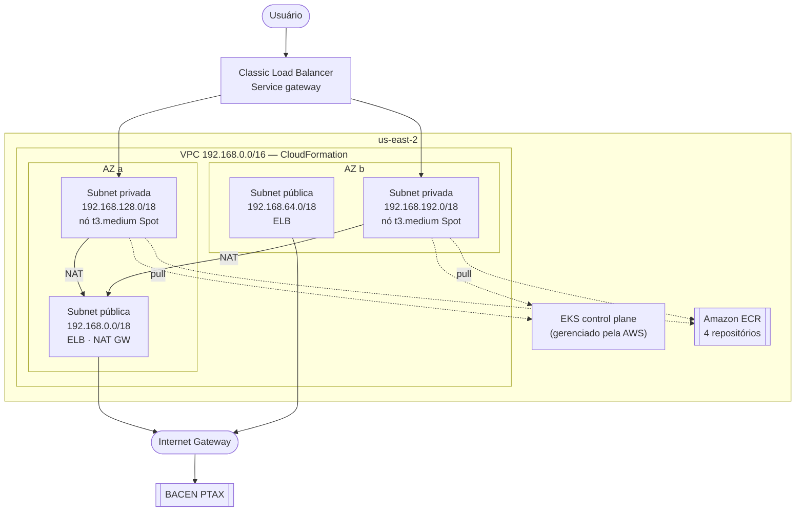

# AWS e EKS

## Infraestrutura

A topologia é a da página *EKS* do enunciado: uma VPC em **us-east-2** com 2 subnets
públicas (load balancer) e 2 privadas (pods/nós) em duas zonas de disponibilidade, criada pelo
template CloudFormation `amazon-eks-vpc-private-subnets.yaml` (copiado em `aws/`, com uma
mudança para cortar custo: **um único NAT Gateway** para as duas subnets privadas, em vez de um
por AZ).



| Script | O que faz |
|--------|-----------|
| `aws/eks-create.sh` | VPC (CloudFormation) → `eksClusterRole` → cluster `eks-store` → `eksNodeRole` (CNI, WorkerNode, ECR read-only) → node group **Spot** `2 x t3.medium/t3a.medium` nas subnets privadas → kubeconfig → metrics-server |
| `scripts/push-images.sh` | cria os repositórios no **ECR** (scan on push + lifecycle policy) e publica as 4 imagens `amd64` |
| `k8s/deploy.sh` | Postgres, Redis e os 4 serviços com as imagens do ECR; segredos reais (JWT); espera os rollouts |
| `aws/rds-create.sh` | (opcional) RDS PostgreSQL 17 `db.t4g.micro` privado, SG liberando 5432 só para os nós |
| `aws/eks-teardown.sh` | apaga ELB → RDS (se houver) → node groups → cluster → VPC → repositórios do ECR |

O passo a passo completo, com conferências e problemas comuns, está no
[AWS Runbook](runbook.md).

## Deploy real no EKS (15/11/2026)

Executado na conta AWS do grupo (IAM Identity Center/SSO, papel `AdministratorAccess`), região
**us-east-2**, seguindo o [AWS Runbook](runbook.md) do começo ao fim:

| Recurso | Resultado |
|---------|-----------|
| VPC (CloudFormation `eks-store-vpc`) | 2 subnets públicas + 2 privadas em `us-east-2a`/`us-east-2b`, 2 NAT Gateways |
| Cluster `eks-store` | **ACTIVE**, Kubernetes **1.37**, endpoint público, *access entries* |
| Node group `eks-store-nodes` | **2 × `t3.medium`** (mín. 2, máx. 3), Amazon Linux 2023, só nas subnets privadas (`192.168.149.x` e `192.168.243.x`) |
| Banco | **Amazon RDS** PostgreSQL **17.9**, `db.t4g.micro`, 20 GB gp3, Single-AZ, **sem IP público**; o Flyway criou o schema `accounts` no primeiro start |
| Imagens | **Amazon ECR** da conta: `account-service`, `auth-service`, `exchange-service`, `gateway-service` (`amd64` + `arm64`, scan on push) |
| Load Balancer | Classic LB do Service `gateway`: **<http://a0fe1d39fd35640c4b0de61fe105bdb5-64525269.us-east-2.elb.amazonaws.com/info>** (portas 80 e 8080) |
| Smoke test pelo ELB | **11/14** — todo o fluxo de conta, login, JWT, rotas seguras e cache; as 3 verificações de câmbio falharam porque a AwesomeAPI recusa IPs da AWS sem API key (abaixo; com a chave, **14/14**) |
| HPA (busybox do enunciado) | gateway **1 → 4 → 8 → 10 réplicas** em ~80 s — [Teste de carga](load-testing.md#resultado-no-eks) |

Esse foi o **primeiro deploy** (≈ US$ 0,34/h). Depois de validado, o ambiente foi reduzido ao
mínimo, com o cluster no ar e sem trocar o endereço do ELB:

### Ambiente atual, otimizado para custo (≈ US$ 0,21/h, −38 %)

| Recurso | Agora |
|---------|-------|
| Nós | node group **`eks-store-spot`**: 2 × `t3.medium` **Spot** (aceita `t3a.medium`; mín. 1, máx. 2), subnets privadas. Subiu ao lado do on-demand, e o EKS drenou os pods para ele |
| NAT | **1 NAT Gateway** para as 2 subnets privadas (`aws cloudformation deploy` com o template alterado removeu o NAT e o Elastic IP da AZ2) |
| Banco | **Postgres no cluster** (`k8s/postgres.yaml`); o RDS foi apagado (sem snapshot). O Flyway recriou o schema no primeiro start |
| Load Balancer | 1 Classic LB, o mesmo endereço de antes |
| ECR | lifecycle policy (sem tag: 1 dia; com tag: as 3 últimas) e imagem órfã apagada (2,55 → 2,05 GB) |
| Smoke test pelo ELB | **14/14** com a API key da AwesomeAPI no Secret `exchange-secrets` (antes dela, 11/14: só o câmbio falhava) |
| Capacidade para o HPA | `kubectl scale deployment gateway --replicas=10`: **10/10 `Running` em 30 s** nos 2 nós Spot, com o Postgres junto (requests de memória a 80 % e 91 %). O HPA com busybox subiu 1 → 2 → 4 → 6 (o limite foi a carga gerada, não os nós) |
| Teardown automático | **3 h** (antes 8 h), a menos que exista `~/KEEP_EKS` |

Detalhes, economia por item e o que ficou de fora (e por quê) em [Custos](custos.md#otimizacoes-aplicadas).

Por que **2 nós**: 1 `t3.medium` (1930m CPU / 3,2 GiB alocáveis) comporta os 5 pods da
aplicação, mas o HPA do gateway só conseguiria subir mais 2–3 réplicas antes de ficarem
`Pending` por memória (cada réplica pede 384 Mi). Com 2 nós o gateway chegou a 10 réplicas com
os nós a 42 % / 26 % de CPU e ~60 % de memória.

!!! success "Câmbio na AWS: AwesomeAPI devolve `429 QuotaExceeded` sem API key (resolvido)"
    Do Mac, `GET https://economia.awesomeapi.com.br/json/last/USD-BRL` responde 200; dos dois NAT
    Gateways da VPC, a mesma chamada devolve `429 {"code":"QuotaExceeded"}` desde a primeira
    requisição (os IPs da AWS já chegam com a cota sem chave estourada). O exchange
    se comporta como projetado: retry, circuit breaker e **503 rápido** no lugar de travar. A
    correção é a API key gratuita (100 mil requisições/mês): o exchange envia o header
    `x-api-key` quando existe `EXCHANGE_PROVIDER_TOKEN`, e o `deploy.sh` cria o Secret
    `exchange-secrets` com ela (`EXCHANGE_PROVIDER_TOKEN=<chave> ./k8s/deploy.sh`), sem passar pelo git.

    Com a chave (guardada num arquivo local, fora do repositório, e lida direto para o Secret com
    `kubectl create secret generic exchange-secrets --from-file=EXCHANGE_PROVIDER_TOKEN=<arquivo>`)
    e um `kubectl rollout restart deployment/exchange`, o smoke test pelo ELB passou a **14/14**
    (15/11, 23:21 UTC).

    **Depois (16/11):** com o aviso do professor, o exchange passou a usar o PTAX do BACEN, que é
    público e não pede chave. A API key e o Secret `exchange-secrets` deixaram de existir
    ([Exchange](exchange.md)).

    **Por fim (22/11):** o Exchange passou a ser o `exchange-py`, o serviço em Python/FastAPI da
    página do BACEN da disciplina (o enunciado pede Python). Como o cluster já tinha sido
    destruído (16/11, 02:30 UTC), nenhuma das versões na PTAX chegou a ser chamada do EKS — a
    AWS não foi recriada para isso, para não gastar. Os manifests estão prontos
    (`api/exchange-py/k8s/k8s.yaml`, aplicado pelo `deploy.sh`), e a conferência que a página
    pede, uma chamada à PTAX de dentro de um pod, está no [Runbook](runbook.md#6-testar).

??? example "Saídas: `kubectl get nodes/pods/svc/hpa`, `kubectl top`, EKS, RDS e ECR"

    ```text
    --8<-- "docs/evidencias/eks-deploy.txt"
    ```

??? example "Ambiente otimizado: nós Spot, recursos da conta, HPA e smoke test"

    ```text
    --8<-- "docs/evidencias/eks-otimizado.txt"
    ```

??? example "Smoke test pelo Load Balancer"

    ```text
    --8<-- "docs/evidencias/smoke-test.txt"
    ```

Os IDs da conta e o identificador do endpoint do RDS foram trocados por `<ACCOUNT_ID>` e `<id>`
nas evidências: nada que identifique a conta vai para o repositório. Os scripts descobrem a
conta em tempo de execução (`aws sts get-caller-identity`).

## Manifests Kubernetes

Cada repositório de serviço tem o seu `k8s/k8s.yaml` (como pede o exercício MiniKube) com
**Secret** (quando há segredo), **ConfigMap**, **Deployment**, **Service** e
**HorizontalPodAutoscaler**. A infraestrutura compartilhada fica no repositório principal:

| Arquivo | Recursos |
|---------|----------|
| `api/account-service/k8s/k8s.yaml` | Secret (usuário/senha do banco), ConfigMap (host, porta, base, Redis), Deployment, Service `ClusterIP`, HPA 1–3 |
| `api/auth-service/k8s/k8s.yaml` | Secret (`JWT_SECRET_KEY`), ConfigMap, Deployment, Service `ClusterIP`, HPA 1–3 |
| `api/exchange-py/k8s/k8s.yaml` | ConfigMap (URL da PTAX, timeout, cache), Deployment (porta 8000, `runAsNonRoot`, sistema de arquivos só leitura), Service `ClusterIP`, HPA 1–3 |
| `api/gateway-service/k8s/k8s.yaml` | ConfigMap (Redis, rate limit), Deployment, Service **`LoadBalancer`** (portas 80 e 8080), HPA **1–10** |
| `k8s/postgres.yaml` | Secret, ConfigMap, Deployment, Service do Postgres (sem volume, como no hands-on 5) |
| `k8s/redis.yaml` | Deployment + Service do Redis (64 MB, LRU) |
| `k8s/ingress.yaml` | (opcional) Ingress ALB — requer o AWS Load Balancer Controller |

??? example "api/gateway-service/k8s/k8s.yaml"

    ```yaml
    --8<-- "api/gateway-service/k8s/k8s.yaml"
    ```

??? example "api/exchange-py/k8s/k8s.yaml"

    ```yaml
    --8<-- "api/exchange-py/k8s/k8s.yaml"
    ```

??? example "api/account-service/k8s/k8s.yaml"

    ```yaml
    --8<-- "api/account-service/k8s/k8s.yaml"
    ```

Escolhas de configuração:

- **Recursos**: `requests` 100m CPU (gateway: 200m) e 384 Mi; `limits` 1 CPU e 512 Mi. O HPA
  calcula a utilização sobre o *request*, então 50 % ≈ 100m de CPU no gateway. O `exchange-py`
  (Python, sem JVM) pede 50m e 96 Mi, com limite de 500m e 256 Mi.
- **Probes**: `startupProbe` (até 3 min para a JVM subir com pouca CPU), `livenessProbe` e
  `readinessProbe` nos health groups do Actuator — o Service só manda tráfego para pods prontos e
  o rolling update não derruba a API. No `exchange-py` as três usam `GET /health` (o uvicorn sobe
  em ~1 s), e a readiness **não** depende da PTAX: com o BCB fora, o pod segue servindo o cache.
- **Segurança do pod** (`exchange-py`): `runAsNonRoot` (a imagem roda como UID 10001),
  `readOnlyRootFilesystem`, `allowPrivilegeEscalation: false`, todas as capabilities removidas e
  seccomp `RuntimeDefault`. A imagem foi testada no Docker com as mesmas restrições
  (`--read-only --cap-drop ALL --security-opt no-new-privileges`), e os manifests passam no
  `kubeconform -strict`.
- **Imagens**: `DOCKERHUB_USER/<serviço>-service` (e `DOCKERHUB_USER/exchange-py`) nos manifests; o `deploy.sh` troca o prefixo
  pelo registry do **ECR** da conta (ou por um usuário do Docker Hub). Só `amd64` (a arquitetura
  dos nós t3), o que deixa o ECR com metade do tamanho; `PLATFORMS=linux/amd64,linux/arm64` gera
  também `arm64` (Mac/Graviton). `imagePullPolicy: IfNotPresent` porque o CI faz deploy com
  a tag imutável `:<sha>`. Os nós baixam do ECR pela role `eksNodeRole`
  (`AmazonEC2ContainerRegistryReadOnly`), sem `imagePullSecrets`.
- **Service do gateway** nas portas 80 e 8080: `http://gateway/info` (o busybox do enunciado) e
  `http://<elb>:8080/info` (hands-on 5) funcionam.
- **`enableServiceLinks: false`**: sem isso o Kubernetes injeta `REDIS_PORT=tcp://<ip>:6379`
  (do Service `redis`) e o Spring falha ao converter a porta — achado no teste em kind
  ([Teste de carga](load-testing.md)).
- **Segredos**: os manifests trazem valores de desenvolvimento; o `deploy.sh` os sobrescreve
  (`JWT_SECRET_KEY` aleatória, senha do RDS gerada com `openssl rand` só no shell).

## Banco de dados: Postgres no cluster ou RDS

| | **Postgres no cluster** (`k8s/postgres.yaml`) — **usado no EKS hoje** | Amazon RDS (`aws/rds-create.sh`) — usado no primeiro deploy |
|-|------------------------------|----------------------------------|
| Modelo | IaaS/CaaS — nós cuidamos | **PaaS** — AWS cuida de patch, backup, failover |
| Persistência | nenhuma (pod recriado = dados perdidos) | EBS gp3 + backups automáticos |
| Custo | ~0 (usa o nó) | + US$ 14/mês (`db.t4g.micro` + 20 GB) |
| Uso | EKS (dev/teste, vídeo), kind, minikube | produção (cenário C de [Custos](custos.md), Multi-AZ) |

A página *EKS* do enunciado sugere RDS ou DynamoDB. O RDS `db.t4g.micro` Single-AZ foi criado e
validado no primeiro deploy (Flyway migrou o schema, smoke test 11/14) e depois apagado, porque
para um ambiente de demonstração o Postgres no cluster basta e economiza US$ 0,019/h.
Trocar é só passar `DATABASE_HOST` ao `deploy.sh`: o `account-service` lê host/porta/base do
ConfigMap e usuário/senha do Secret, e o **Flyway** cria o schema no primeiro start.
