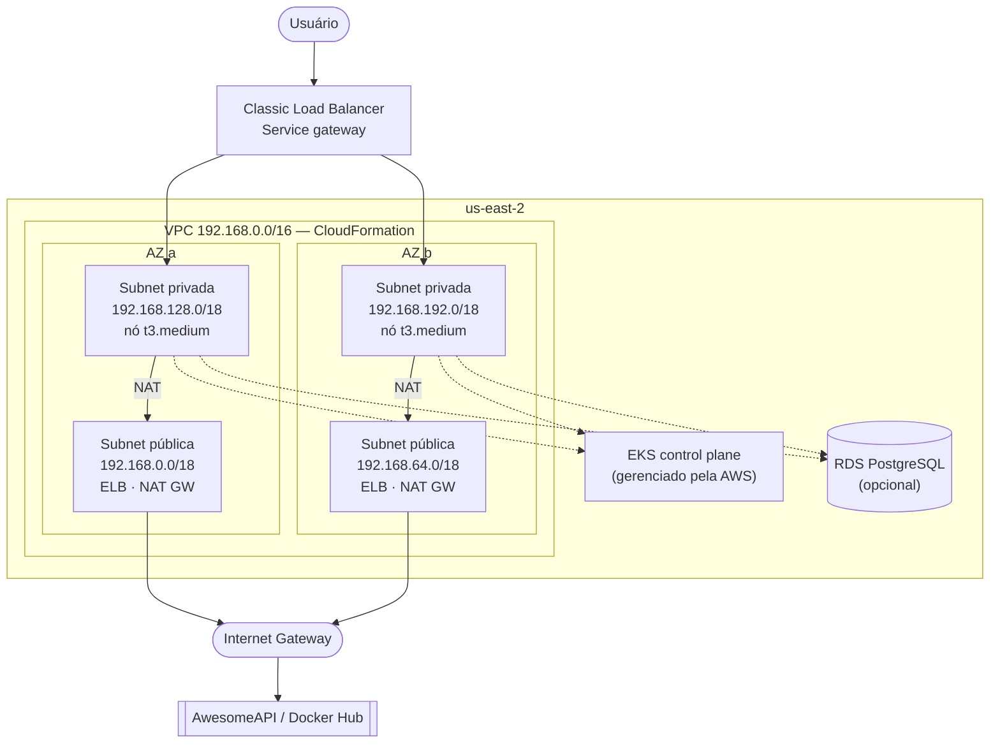

# AWS e EKS

## Infraestrutura

A topologia é a da página *EKS* do enunciado: uma VPC em **us-east-2** com 2 subnets
públicas (load balancer) e 2 privadas (pods/nós) em duas zonas de disponibilidade, criada pelo
template CloudFormation `amazon-eks-vpc-private-subnets.yaml` (copiado em `aws/`).



| Script | O que faz |
|--------|-----------|
| `aws/eks-create.sh` | VPC (CloudFormation) → `eksClusterRole` → cluster `eks-store` → `eksNodeRole` (CNI, WorkerNode, ECR read-only) → node group `2 x t3.medium` nas subnets privadas → kubeconfig → metrics-server |
| `aws/rds-create.sh` | (opcional) RDS PostgreSQL 17 `db.t4g.micro` privado, SG liberando 5432 só para os nós |
| `k8s/deploy.sh` | Redis, Postgres (se não houver RDS) e os 4 serviços; segredos reais; espera os rollouts |
| `aws/eks-teardown.sh` | apaga ELB → RDS → node group → cluster → VPC |

O passo a passo completo, com conferências e problemas comuns, está no
[AWS Runbook](runbook.md).

!!! warning "Status"
    Os scripts e manifests estão prontos e validados (sintaxe com `shellcheck`, manifests com
    `kubeconform`, aplicação testada com Docker Compose **e os mesmos manifests implantados num
    cluster Kubernetes local (kind)**, com smoke test 15/15 e HPA escalando), mas **nenhum recurso
    pago foi criado** — a execução no EKS depende das credenciais AWS do aluno (ver Runbook).

## Manifests Kubernetes

Cada repositório de serviço tem o seu `k8s/k8s.yaml` (como pede o exercício MiniKube) com
**Secret** (quando há segredo), **ConfigMap**, **Deployment**, **Service** e
**HorizontalPodAutoscaler**. A infraestrutura compartilhada fica no repositório principal:

| Arquivo | Recursos |
|---------|----------|
| `api/account-service/k8s/k8s.yaml` | Secret (usuário/senha do banco), ConfigMap (host, porta, base, Redis), Deployment, Service `ClusterIP`, HPA 1–3 |
| `api/auth-service/k8s/k8s.yaml` | Secret (`JWT_SECRET_KEY`), ConfigMap, Deployment, Service `ClusterIP`, HPA 1–3 |
| `api/exchange-service/k8s/k8s.yaml` | ConfigMap (Redis, URL do provedor), Deployment, Service `ClusterIP`, HPA 1–3 |
| `api/gateway-service/k8s/k8s.yaml` | ConfigMap (Redis, rate limit), Deployment, Service **`LoadBalancer`** (portas 80 e 8080), HPA **1–10** |
| `k8s/postgres.yaml` | Secret, ConfigMap, Deployment, Service do Postgres (sem volume, como no hands-on 5) |
| `k8s/redis.yaml` | Deployment + Service do Redis (64 MB, LRU) |
| `k8s/ingress.yaml` | (opcional) Ingress ALB — requer o AWS Load Balancer Controller |

??? example "api/gateway-service/k8s/k8s.yaml"

    ```yaml
    --8<-- "api/gateway-service/k8s/k8s.yaml"
    ```

??? example "api/account-service/k8s/k8s.yaml"

    ```yaml
    --8<-- "api/account-service/k8s/k8s.yaml"
    ```

Escolhas de configuração:

- **Recursos**: `requests` 100m CPU (gateway: 200m) e 384 Mi; `limits` 1 CPU e 512 Mi. O HPA
  calcula a utilização sobre o *request*, então 50 % ≈ 100m de CPU no gateway.
- **Probes**: `startupProbe` (até 3 min para a JVM subir com pouca CPU), `livenessProbe` e
  `readinessProbe` nos health groups do Actuator — o Service só manda tráfego para pods prontos e
  o rolling update não derruba a API.
- **Imagens**: `DOCKERHUB_USER/<serviço>-service`, multi-arch (`amd64` para os nós t3, `arm64`
  para Mac/Graviton). `imagePullPolicy: IfNotPresent` porque o CI faz deploy com a tag imutável
  `:<sha>` (e o Docker Hub limita pulls anônimos).
- **Service do gateway** nas portas 80 e 8080: `http://gateway/info` (o busybox do enunciado) e
  `http://<elb>:8080/info` (hands-on 5) funcionam.
- **`enableServiceLinks: false`**: sem isso o Kubernetes injeta `REDIS_PORT=tcp://<ip>:6379`
  (do Service `redis`) e o Spring falha ao converter a porta — achado no teste em kind
  ([Teste de carga](load-testing.md)).
- **Segredos**: os manifests trazem valores de desenvolvimento; o `deploy.sh` os sobrescreve
  (`JWT_SECRET_KEY` aleatória, credenciais do RDS).

## Banco de dados: Postgres no cluster ou RDS

| | Postgres no cluster (padrão) | Amazon RDS (`aws/rds-create.sh`) |
|-|------------------------------|----------------------------------|
| Modelo | IaaS/CaaS — nós cuidamos | **PaaS** — AWS cuida de patch, backup, failover |
| Persistência | nenhuma (pod recriado = dados perdidos) | EBS gp3 + backups automáticos |
| Custo | ~0 (usa o nó) | + US$ 14/mês (`db.t4g.micro` + 20 GB) |
| Uso | demonstração / vídeo | produção |

Trocar é só passar `DATABASE_HOST` ao `deploy.sh`: o `account-service` lê host/porta/base do
ConfigMap e usuário/senha do Secret, e o **Flyway** cria o schema no primeiro start.
