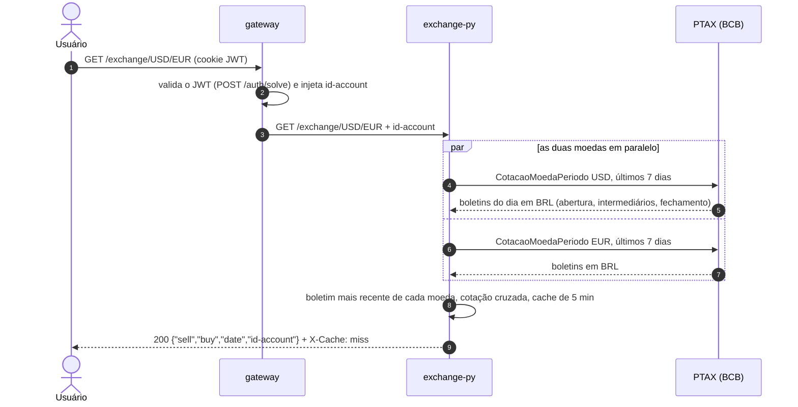
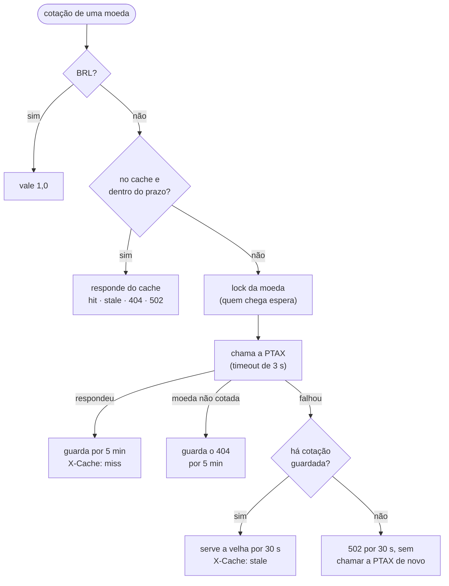

# Exchange

**Código:** [`api/exchange-py/`](https://github.com/EuMiguelll/Projeto-PMA/tree/main/api/exchange-py) no
repositório principal · Python 3.12, **FastAPI**, httpx, uv · porta 8000 (só o gateway chega nele)

Cotações de câmbio (exercício *Exchange API*): `GET /exchanges/{from}/{to}` responde
`{"sell", "buy", "date", "id-account"}` para um usuário autenticado, a partir da
[PTAX do Banco Central do Brasil](https://olinda.bcb.gov.br/olinda/servico/PTAX/versao/v1/aplicacao#!/recursos)
(BCB), consultada direto nos endpoints OData do BACEN: pública, sem chave e sem cadastro.

!!! success "Usamos o serviço do BACEN da disciplina"
    O Exchange é o serviço FastAPI da página
    [API de Câmbio: serviço do BACEN](https://insper.github.io/platform/2026.2/exercises/exchange/bacen/)
    (cotação cruzada via BRL, janela de 7 dias, cache em memória com lock por moeda, cotação
    velha quando a PTAX falha, header `X-Cache`), com o contêiner, a integração e os testes
    feitos por nós e algumas [melhorias](#o-que-mudamos-no-servico-da-disciplina) que mantêm o
    contrato. Escolhemos esse caminho porque o enunciado pede o Exchange **em Python** e porque
    APIs de câmbio gratuitas recusam IPs da AWS: a AwesomeAPI, que usávamos, devolveu
    `429 QuotaExceeded` no EKS ([AWS e EKS](eks.md#deploy-real-no-eks-15112026)). O professor
    avisou (16/11) para consultar o BACEN direto. A versão anterior, em Java, está
    [no fim desta página](#versao-anterior-exchange-service-em-java).

## Contrato

| Método e caminho | Resposta |
|------------------|----------|
| `GET /exchanges/{from}/{to}` (enunciado) e `GET /exchange/{from}/{to}` (página do BACEN) | `200 {"sell", "buy", "date", "id-account"}` + header `X-Cache: miss \| hit \| stale` |
| `GET /exchange/currencies` | as moedas que a PTAX cota (além do BRL) |
| `GET /exchange/docs` | Swagger UI (OpenAPI em `/exchange/openapi.json`) |
| `GET /health` | `{"status": "ok"}`: probes do Kubernetes e `HEALTHCHECK` do Docker (fora do gateway) |
| `GET /metrics` | métricas Prometheus (fora do gateway) |

Pelo gateway, com o cookie do login (saída real de 22/11/2026, [evidência](#evidencias)):

```console
$ curl -si -b cookies.txt http://localhost:8080/exchange/USD/EUR
HTTP/1.1 200 OK
x-cache: miss
{"sell":0.910763,"buy":0.910487,"date":"2026-11-19 13:04:18","id-account":"f1d7aabf-f45e-4dbc-aff7-cff4a5b70b10"}

$ curl -si -b cookies.txt http://localhost:8080/exchanges/USD/BRL
HTTP/1.1 200 OK
x-cache: hit
{"sell":5.8889,"buy":5.8883,"date":"2026-11-19 13:04:18","id-account":"f1d7aabf-f45e-4dbc-aff7-cff4a5b70b10"}
```

| Situação | Código | Corpo |
|----------|-------:|-------|
| sem o cookie JWT (ou token inválido) | `401` | barrado no gateway, antes do exchange |
| código fora do formato ISO 4217 (`US`, `USDT`, `US$`, `U'D`) | `422` | erro de validação do FastAPI, sem chamar a PTAX |
| sem o header `id-account` (só chamando o serviço direto) | `422` | o gateway sempre injeta o header a partir do token |
| moeda que a PTAX não cota (`XYZ`) | `404` | `{"detail": "Unknown currency: XYZ"}` |
| PTAX fora do ar e nenhuma cotação guardada | `502` | `{"detail": "PTAX unavailable and nothing cached for USD"}` |

O gateway remove qualquer `id-account` enviado pelo cliente e coloca o da conta do token
(smoke test: um `id-account: hacker` forjado é descartado), então o serviço confia no header.

## Como funciona



O serviço pede à PTAX os boletins de cada moeda **em reais** dos últimos 7 dias (fim de semana
e feriado não têm boletim, e 7 dias sempre contêm um dia útil), fica com o mais recente e
guarda a cotação em memória por `CACHE_SECONDS` (5 min). Enquanto uma moeda é atualizada, as
outras requisições da mesma moeda esperam essa atualização em vez de chamar o BCB junto (lock
por moeda). Para cada moeda do par:



`X-Cache` diz de onde veio a resposta: `miss` (a PTAX foi chamada), `hit` (cotação em memória)
ou `stale` (a PTAX falhou e uma cotação vencida foi usada).

### Cotação cruzada via BRL

A PTAX só cota moedas contra o real. Com \(c\) a cotação de compra e \(v\) a de venda, em BRL,
o par `USD/EUR` sai assim (BRL vale 1, então `USD/BRL` é a própria PTAX do dólar):

\[
\text{buy} = \frac{c_\text{USD}}{v_\text{EUR}}
\qquad\qquad
\text{sell} = \frac{v_\text{USD}}{c_\text{EUR}}
\]

`buy` é o que o mercado paga por 1 USD, em euros (compra os seus dólares e vende euros), e
`sell` é o que ele cobra; por isso `sell ≥ buy`. Com o fechamento de 19/11/2026:

| | compra \(c\) (BRL) | venda \(v\) (BRL) |
|-|-------------------:|------------------:|
| USD | 5,8883 | 5,8889 |
| EUR | 6,4659 | 6,4672 |
| **USD/EUR** | **buy** = 5,8883 ÷ 6,4672 = **0,910487** | **sell** = 5,8889 ÷ 6,4659 = **0,910763** |

O `date` é o boletim usado, no horário de Brasília. No domingo, 22/11/2026, ele foi o
fechamento de **quinta, 19/11**: sexta (20/11) foi feriado (Consciência Negra) e o fim de
semana não tem PTAX. A mesma janela cobre o caso de antes das 10 h de um dia útil.

## O que mudamos no serviço da disciplina

O contrato (rotas, JSON, `X-Cache`, variáveis de ambiente) é o mesmo da página do BACEN. As
mudanças corrigem situações que medimos ou que os testes mostraram:

| Situação | Serviço da página | exchange-py |
|----------|-------------------|-------------|
| PTAX **lenta**, sem cache, 10 requisições simultâneas | quem espera o lock tenta a PTAX de novo, uma depois da outra: 502 em 3, 6, 9… **30 s** | a falha fica marcada por `RETRY_SECONDS`: 1 chamada e as 10 respostas em **~3 s** ([evidência](#evidencias)) |
| Corpo do 502 | `PTAX unavailable: ReadTimeout('')` (exceção interna) | `PTAX unavailable and nothing cached for USD` (o detalhe vai para o log) |
| Código de moeda | entra na URL OData como veio | validado (`^[A-Za-z]{3}$`) → `422`; aspas e `&` nunca chegam à PTAX |
| Moeda desconhecida | chama a PTAX a cada requisição | o `404` também fica em cache por 5 min |
| As duas moedas do par | uma depois da outra | em paralelo (`asyncio.gather`) |
| Boletim mais recente | o último da lista | o de maior `dataHoraCotacao` (não depende da ordem) |
| Data de hoje | do contêiner (UTC: de 21 h a 0 h, já é amanhã) | a de Brasília |
| `/exchange/currencies` | chama a PTAX toda vez | mesmo cache e mesmo stale das cotações |
| Observabilidade | — | `/metrics` com os nomes do Micrometer: o exchange entra no dashboard do Grafana |
| Contêiner | (tarefa do aluno) | `python:3.12-slim` + uv, `uv sync --frozen --no-dev`, UID 10001, `HEALTHCHECK`, roda com o sistema de arquivos só leitura |

Métricas próprias (além de `http_server_requests_seconds`, com o template da rota):

| Métrica | O que conta |
|---------|-------------|
| `ptax_requests_total{outcome="ok\|not_found\|error"}` | chamadas de verdade ao BCB |
| `exchange_rate_responses_total{cache="miss\|hit\|stale"}` | cotações respondidas, pelo `X-Cache` |
| `ptax_request_duration_seconds` | duração das chamadas à PTAX |

## Código

=== "main.py"

    ```python
    --8<-- "api/exchange-py/main.py"
    ```

=== "Dockerfile"

    ```dockerfile
    --8<-- "api/exchange-py/Dockerfile"
    ```

=== "pyproject.toml"

    ```toml
    --8<-- "api/exchange-py/pyproject.toml"
    ```

=== "k8s/k8s.yaml"

    ```yaml
    --8<-- "api/exchange-py/k8s/k8s.yaml"
    ```

O `Dockerfile` segue a página do BACEN: base `python:3.12-slim`, o binário do `uv` copiado de
`ghcr.io/astral-sh/uv` (versão fixa), `pyproject.toml` e `uv.lock` copiados **antes** do
`main.py` e `uv sync --frozen` (mudar o código não reinstala as dependências), e
`uvicorn main:app` em `0.0.0.0:8000`. O `--no-dev` deixa o pytest fora da imagem
(≈ 94 MB comprimida). No `compose.yaml` o serviço `exchange` não publica porta: só o gateway
chega nele, pelas rotas `/exchange/**` e `/exchanges/**` → `http://exchange:8000`, autenticadas
como as outras ([Gateway](gateway.md)).

| Variável | Padrão | O que define |
|----------|--------|--------------|
| `PTAX_URL` | `https://olinda.bcb.gov.br/olinda/servico/PTAX/versao/v1/odata` | URL base da API OData da PTAX (no E2E, o stub) |
| `PTAX_TIMEOUT` | `3` | segundos de espera pela PTAX |
| `CACHE_SECONDS` | `300` | por quanto tempo uma cotação (ou um 404) é reaproveitada |
| `RETRY_SECONDS` | `30` | depois de uma falha, por quanto tempo a PTAX não é chamada de novo: serve a cotação velha (`stale`) ou `502` |

## Limites da PTAX

- **Horário:** há boletins só em dias úteis, entre ~10 h e ~13 h de Brasília (abertura,
  intermediários e fechamento). Fora disso o serviço devolve o último boletim, e o `date` mostra
  qual foi.
- **Moedas:** só as 10 que o BCB cota contra o real (AUD, CAD, CHF, DKK, EUR, GBP, JPY, NOK, SEK e
  USD), além do próprio BRL; o resto é `404`.
- **Cache em memória, por processo:** um contêiner reiniciado chama a PTAX de novo; com o HPA
  em 3 réplicas, são até 3 chamadas por moeda a cada 5 min. Sem resposta do BCB e sem cotação
  guardada, o serviço responde `502`.
- **Nada de teste de carga na PTAX:** é um serviço público. Com o cache, 300 requisições pelo
  gateway viraram **1** chamada ao BCB (`ptax_requests_total`, [evidência](#evidencias)); o teste
  de carga do projeto mira o `/info` do gateway ([Teste de carga](load-testing.md)).
- **AWS:** a disciplina indica a PTAX justamente porque ela responde a IPs da AWS. Nós não
  chegamos a chamá-la do EKS: o cluster foi destruído em 16/11 às 02:30 UTC
  ([teardown](custos.md#custo-real-do-deploy-de-15112026)), antes da troca para o BACEN
  (16/11, à tarde). Fora da AWS ela respondeu ao Mac (16/11) e a uma VM de datacenter do
  Google Cloud (22/11). Num deploy novo, a conferência pedida pela página é uma chamada de
  dentro de um pod ([Runbook](runbook.md#6-testar)).

## Testes

`api/exchange-py/tests` — **37 testes** com a PTAX simulada pelo `respx` (nenhum sai para a
rede) e **2** contra a PTAX real, marcados `live` e fora do `pytest` padrão:

| Grupo | O que conferem |
|-------|----------------|
| Cotação | `USD/EUR` cruzada (0,910763 / 0,910487 com os boletins reais de 19/11), a direção da fórmula com números redondos, `USD/BRL` = PTAX do dólar (só o USD vai à PTAX), `BRL/USD` = inverso, `/exchanges` = `/exchange`, minúsculas |
| Fim de semana | domingo 22/11 → janela `11-15-2026`…`11-22-2026` e o fechamento de quinta; boletim escolhido pela data, não pela posição |
| Erros | `404` (origem, destino, `XXX/YYY`) e o 404 em cache; `422` sem `id-account` e com código inválido, sem chamar a PTAX; `502` sem cache para timeout, conexão recusada, 500, 429, HTML e JSON sem `value`, sem detalhes internos; falha rápida |
| Cache | `miss` → `hit`, cache por moeda entre pares, expiração, `stale` com a PTAX fora e nova chamada depois de `RETRY_SECONDS`; **20 requisições simultâneas → 2 chamadas** à PTAX |
| Outros | `/exchange/currencies` (e cache e 502), `/health`, `/metrics` (contadores e o template da rota), OpenAPI com o contrato |

```console
$ cd api/exchange-py && uv run pytest
37 passed, 2 deselected in 1.79s
$ uv run pytest -m live -s        # PTAX real
GET /exchange/USD/EUR -> 200 miss {"sell":0.910763,"buy":0.910487,"date":"2026-11-19 13:04:18",...}
2 passed, 37 deselected in 2.63s
```

Conferimos que os testes pegam erros de verdade: com a fórmula invertida, o regex sem âncora,
sem o lock por moeda, com o boletim pela posição, com uma janela de 1 dia, sem o stale ou sem o
cache de 404, a suíte falha (de 1 a 13 testes em cada caso). No CI, o workflow
[`exchange-py`](cicd.md#exchange-py-python) roda o pytest, o ruff, constrói a imagem e testa o
contêiner; o E2E sobe a plataforma com um stub da PTAX e roda o smoke test (18 verificações,
7 delas do exchange).

## Evidências

??? example "PTAX real: direto e pelo gateway (22/11/2026)"

    ```text
    --8<-- "docs/evidencias/exchange-py-ptax.txt"
    ```

??? example "Cache, carga leve, PTAX fora e PTAX lenta (lado a lado com o serviço original)"

    ```text
    --8<-- "docs/evidencias/exchange-py-cache.txt"
    ```

## Versão anterior: `exchange-service` em Java

Até 21/11 o Exchange era um serviço **Spring Boot** ([`exchange`](https://github.com/canavero/exchange)
\+ [`exchange-service`](https://github.com/canavero/exchange-service), submódulos em `api/`),
no mesmo padrão dos outros três: `RestClient` para o provedor, cache Redis de 60 s, retry e
circuit breaker do Resilience4j. Começou na AwesomeAPI e passou para a PTAX em 16/11; foi com
ele que o deploy no EKS rodou ([evidências](eks.md#deploy-real-no-eks-15112026)). Os dois
submódulos continuam no repositório e o `./scripts/build.sh` ainda os compila e testa, mas eles
saíram do `compose.yaml`, do Kubernetes e das rotas do gateway: o Exchange da plataforma é o
`exchange-py`, que segue o enunciado (Python) e a página do BACEN da disciplina.
