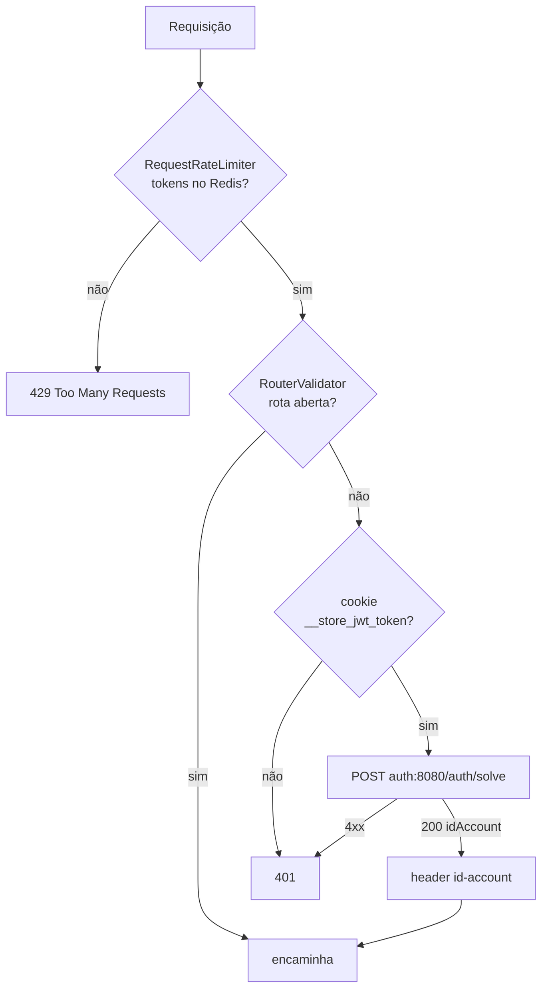

# Gateway

**Repositório:** [`gateway-service`](https://github.com/canavero/gateway-service) · pacote `store.gateway`

Ponto único de entrada (hands-on 2 e 3): roteia as requisições, valida o JWT antes de qualquer
rota segura, aplica **rate limiting** e expõe `/health-check` e `/info`. É o único serviço com
porta publicada (compose) / `Service` `LoadBalancer` (Kubernetes).

| Método | Caminho | Acesso | Descrição |
|--------|---------|--------|-----------|
| GET | `/health-check` | aberto | `{"hostname": "<pod>"}` — mostra qual réplica respondeu |
| GET | `/info` | aberto | nome, versão, hostname, versão do Java, uptime, CPUs — alvo do teste de carga |
| * | `/auth/**` | aberto: `POST /auth/register`, `POST /auth/login`, `GET /auth/logout`; o resto exige cookie | → `auth:8080` |
| * | `/accounts/**` | cookie JWT | → `account:8080` |
| * | `/exchanges/**` (enunciado) e `/exchange/**` (página do BACEN) | cookie JWT | → `exchange:8000` ([exchange-py](exchange.md), FastAPI) |
| GET | `/gateway/actuator/{health,prometheus}` | interno | probes e métricas |

## Como funciona a autorização

Os health-checks dos serviços (`/accounts/health-check`, `/auth/health-check`,
`/exchange/health-check`) são rotas roteadas como as outras: passam pelo filtro e, sem o cookie,
recebem `401`. O `/health-check` do gateway é dele mesmo, não é roteado, e por isso é aberto
(é o alvo do health check do ALB no `k8s/ingress.yaml`).



=== "AuthorizationFilter.java"

    ```java
    --8<-- "api/gateway-service/src/main/java/store/gateway/security/AuthorizationFilter.java"
    ```

=== "RouterValidator.java"

    ```java
    --8<-- "api/gateway-service/src/main/java/store/gateway/security/RouterValidator.java"
    ```

=== "GatewayResource.java"

    ```java
    --8<-- "api/gateway-service/src/main/java/store/gateway/GatewayResource.java"
    ```

=== "application.yaml"

    ```yaml
    --8<-- "api/gateway-service/src/main/resources/application.yaml"
    ```

Diferenças em relação ao código de referência do hands-on 3: o `WebClient` é criado uma vez (e
não a cada requisição), os erros viram `Mono.error` em vez de `throw`, a URL do `/auth/solve` e
as URIs das rotas são configuráveis por variável de ambiente, e foi adicionado o
`RequestRateLimiter` (ver [Bottlenecks](bottlenecks.md#3-rate-limiting-gateway)).

## Testes

`RouterValidatorTest` — rotas abertas (login, register, logout) vs. seguras (inclusive
`GET /auth/login`, método errado, `POST /auth/solve` e as duas rotas do exchange).
`RoutesTest` — sobe o contexto do Spring e passa caminhos reais pelos predicados do
`application.yaml`: `/exchanges/USD/BRL`, `/exchange/USD/EUR` e `/exchange/currencies` vão para
`http://exchange:8000`, e um prefixo parecido (`/exchangesX/...`) não casa com nenhuma rota. O comportamento ponta a ponta
(401 sem cookie, 401 com token forjado, header `id-account` forjado descartado) é coberto pelo
[smoke test](local.md#smoke-test).
