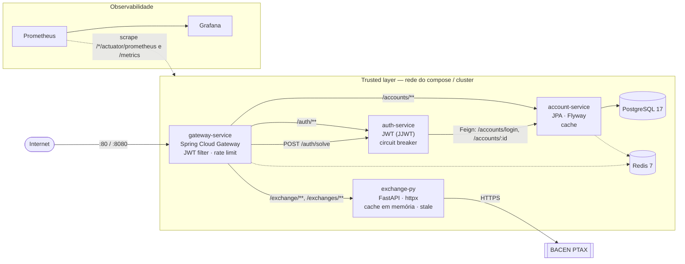
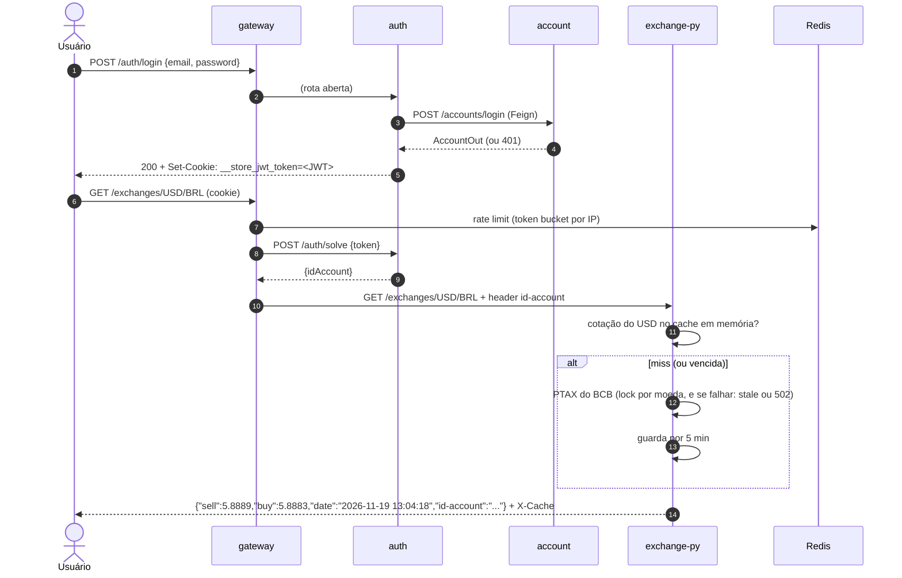

# Visão geral e arquitetura

A arquitetura segue a da disciplina (hands-on 1–3): cada microsserviço Java tem um **módulo de
interface** (`account`, `auth`, `exchange` — contrato REST como interface `@FeignClient` + DTOs
em `record`) e um **módulo de serviço** executável (`*-service`) que implementa essa interface.
Assim, quem precisa chamar um serviço (ex.: o `auth-service` chamando o `account`) só depende
do jar da interface e o Feign gera o cliente HTTP.

O **Exchange** é a exceção: o enunciado pede Python, então ele é o serviço **FastAPI** da página
*API de Câmbio: serviço do BACEN* da disciplina, em `api/exchange-py/` do repositório principal,
sem módulo de interface (o contrato é o HTTP do enunciado). A versão Java anterior
(`exchange` + `exchange-service`) continua nos submódulos, fora do gateway ([Exchange](exchange.md)).

## Componentes



| Serviço | Pacote | Porta | Endpoints principais | Dependências |
|---------|--------|------:|----------------------|--------------|
| gateway | `store.gateway` | 8080 (única exposta) | `GET /health-check`, `GET /info`, rotas `/auth/**`, `/accounts/**`, `/exchange/**`, `/exchanges/**` | auth, Redis |
| auth | `store.auth` | 8080 | `POST /auth/register`, `POST /auth/login`, `GET /auth/me`, `POST /auth/solve`, `GET /auth/logout` | account |
| account | `store.account` | 8080 | `POST /accounts`, `GET /accounts`, `GET/DELETE /accounts/{id}`, `POST /accounts/login` | PostgreSQL, Redis |
| exchange | `api/exchange-py/main.py` (FastAPI) | 8000 | `GET /exchanges/{from}/{to}` (e `/exchange/...`), `GET /exchange/currencies` | BACEN (PTAX) |

Os serviços Java expõem `/<prefixo>/actuator/health/{liveness,readiness}` (probes do
Kubernetes) e `/<prefixo>/actuator/prometheus` (métricas), com o prefixo do próprio serviço como
no hands-on 6; o `exchange-py` expõe `/health` e `/metrics` (com os mesmos nomes de métricas
HTTP do Micrometer), fora das rotas do gateway.

## Stack

| Camada | Tecnologia |
|--------|------------|
| Linguagem / framework | Java 25, Spring Boot 4.1.1, Spring Cloud 2025.1.3; exchange: Python 3.12, FastAPI, uvicorn |
| Gateway | Spring Cloud Gateway Server WebFlux (reativo, Netty) |
| Comunicação interna | OpenFeign (auth → account), httpx assíncrono (exchange → BACEN), WebClient (gateway → auth) |
| Segurança | JWT HS256 (JJWT 0.13) em cookie `HttpOnly`, validado no gateway |
| Persistência | PostgreSQL 17, Spring Data JPA, Flyway |
| Resiliência | Resilience4j 2.4 (circuit breaker, retry), rate limiter Redis do Spring Cloud Gateway; exchange: lock por moeda, *stale* e falha rápida |
| Cache | Redis 7 + Spring Cache (account); memória do processo (exchange) |
| Observabilidade | Actuator + Micrometer e prometheus-client (exchange) → Prometheus → Grafana |
| Build | Maven Wrapper (`./mvnw`), Docker (`eclipse-temurin:25-jre`); exchange: uv + `uv.lock`, Docker (`python:3.12-slim`) |
| Orquestração | Docker Compose (local), Kubernetes / Amazon EKS |
| CI/CD | GitHub Actions → Amazon ECR (ou Docker Hub) → EKS |

## Fluxo de uma requisição autenticada



O gateway **remove** qualquer header `id-account` vindo do cliente (`RemoveRequestHeader`) e só
o recoloca a partir do token validado — os serviços confiam nesse header sem precisar validar
JWT (testado no smoke test: um `id-account: hacker` forjado é descartado).

## Estrutura do repositório principal

```text
platform/
├── api/                      # submódulos (um repositório por módulo)
│   ├── account/  account-service/
│   ├── auth/     auth-service/
│   ├── exchange-py/          # Exchange em Python/FastAPI (pasta deste repositório, não submódulo)
│   ├── exchange/ exchange-service/   # versão anterior do Exchange (Java)
│   └── gateway-service/
├── aws/                      # eks-create.sh, rds-create.sh, eks-teardown.sh, template da VPC
├── k8s/                      # postgres.yaml, redis.yaml, ingress.yaml, deploy.sh
├── load-test/                # busybox.sh (enunciado), k6.js, README (roteiro do vídeo)
├── setup/                    # prometheus.yml, provisionamento do Grafana (datasource + dashboard)
├── scripts/                  # build.sh, smoke-test.sh, push-images.sh
├── presentation/slides.md    # slides (Marp)
├── docs/ + mkdocs.yml        # esta documentação
├── compose.yaml
├── AWS_RUNBOOK.md
└── publish.sh                # cria os repositórios no GitHub e faz o push
```

Cada repositório de serviço contém: código, testes, `Dockerfile`, `k8s/k8s.yaml` (como pede o
exercício MiniKube) e `.github/workflows/ci.yml`. O `api/exchange-py` tem o mesmo formato
(`main.py`, `tests/`, `Dockerfile`, `k8s/k8s.yaml`), com o workflow em
`.github/workflows/exchange-py.yml` do repositório principal.
